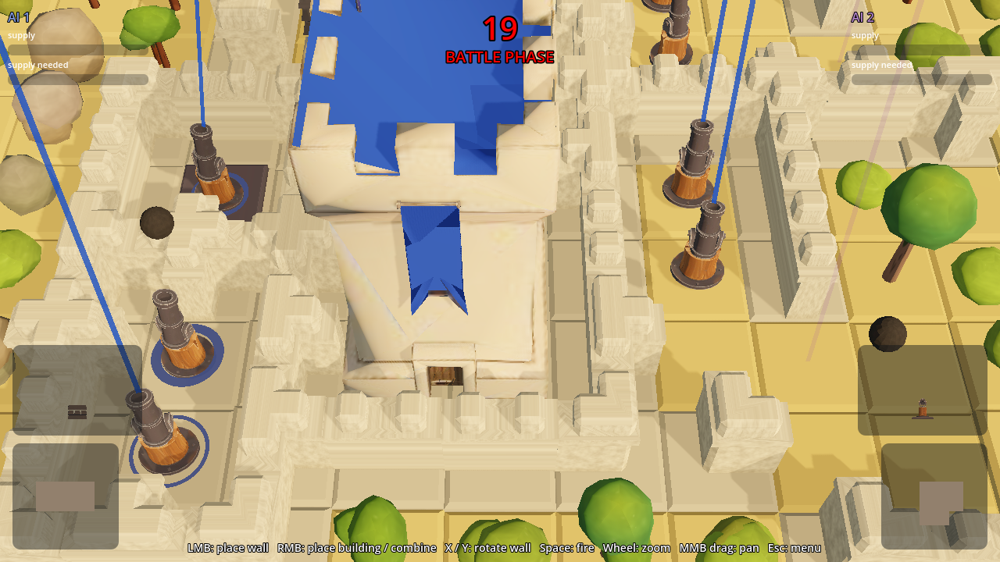

# Cannonade

Enclose castles with walls, mount cannons inside, shoot the enemy's walls apart, rebuild,
repeat: a Rampart-style castle game that runs in the browser. Play it at
[moonlightart.itch.io/cannonade](https://moonlightart.itch.io/cannonade).



A Godot 4.7.2 game in GDScript, ported from a Unity 2018.3 original. Grid Cannons is the
project name in the code and the docs. The licence and the credits are at the
[end of this file](#licence-and-credits).

## Running

Open this folder (`project.godot`) in Godot 4.7.2 and press Play. The first import takes a few
seconds. From the command line:

```sh
godot --path .                                          # main menu
godot --path . res://scenes/game.tscn -- --mode=versus  # straight into a game
```

| mode       | menu entry    | setup                                         |
|------------|---------------|-----------------------------------------------|
| `versus`   | Player vs. AI | you against one AI, 52×34 map, ten castles    |
| `ai2`      | Watch         | two AIs, same map                             |
| `practice` | Practice      | the versus map with a dormant enemy, no timer |

`single` and `ai4` are parked: their code and files stay, the menu does not offer them. In
`practice`, Enter steps to the next phase, so you can try the rules check on your own walls.

Options after `--`:

| option                 | sets                                            |
|------------------------|-------------------------------------------------|
| `--seed=N`             | the random seed of the map and the draws        |
| `--walls=SECONDS`      | the wall phase                                  |
| `--guns=SECONDS`       | the cannon phase                                |
| `--battle=SECONDS`     | the battle                                      |
| `--ready=SECONDS`      | the banner before each phase, 0 for none        |
| `--size=TILES`         | the map depth                                   |
| `--width=TILES`        | the map width                                   |
| `--timescale=F`        | the game speed                                  |
| `--quit-after=SECONDS` | when the game quits on its own                  |
| `--no-decorations`     | no trees, bushes and boulders                   |

## Controls

| input                      | action                                                        |
|----------------------------|---------------------------------------------------------------|
| left mouse (wall phase)    | place the wall piece, or stack it on your walls               |
| left mouse (cannon phase)  | place the cannon at its parts cost, or fuse it onto three cannons |
| left mouse (battle)        | fire                                                          |
| click outside the map      | discard the current piece or building                         |
| X                          | turn the wall piece clockwise                                 |
| Y or Z                     | turn the wall piece counter-clockwise                         |
| mouse wheel                | zoom in and out towards the cursor, fully out shows the whole map |
| middle mouse drag          | pan the view while zoomed in                                  |
| Enter                      | step to the next phase (`practice` only)                      |
| K / L                      | testing keys: win or lose the running game at once            |
| Esc                        | pause menu (volume, restart, menu), Esc again resumes         |

The keys are the player 1 settings of the Unity original.

## Rules

### Walls

Walls come as pieces, Rampart style: one block, two, three or four in a row, an S, a T or a
cross. Pieces are drawn at random, small ones more often, and turned with X / Y. A piece stamps
a full-tile wall block on each of its cells.

Blocks that share a side are one wall. Blocks that touch only at a corner do not join, so a
ring must close side to side.

Everything you place needs one tile within two tiles of your own walls or of a castle you
hold, with a straight line of empty ground between it and that wall or castle. So nobody
builds behind enemy lines, inside an enemy's half-built room, or on ground that another
player's closed ring holds. The AI keeps the same rules.

A piece stacks wherever your walls fill every tile under it, whichever pieces placed them, as
long as none of those tiles has a storey yet. A stacked tile takes two shells. Held over your
walls, the piece shows the storeys it adds, red where it cannot stack. The cursor on a block
picks that block, not the ground hidden behind it.

A wall shot down breaks into pieces that fly from the shot, land on the walls around and sink
into the ground. So do a gun, the castle as it falls to ruins, and the trees, bushes and
boulders of a tile that is shot or built on.

Every game deals each player a different wall look of four. The walkway along the top of a
wall carries the owner's colour, running toward the neighbouring blocks of the same wall. The
ground inside a closed ring takes a wash of the colour of the player whose walls encircle it
alone. A ring two factions share encircles nothing and the ground stays open.

### A round

A round is three phases, each starting with its own call:

| phase         | length                                                  | call    |
|---------------|---------------------------------------------------------|---------|
| build walls   | 45 s                                                    | bell    |
| place cannons | one second per cannon the fullest hand can place        | whistle |
| battle        | 30 s, over early once neither side holds a cannon and no shell is in the air | horn |

A small banner in the middle counts each phase in for 2 seconds. Nobody acts while it shows.
The plaque at the top counts the phase down and names it, its last five seconds in red. The
line at the bottom names the controls of the phase.

You hold one thing at a time and see it only where you point: the wall piece in the wall
phase, a drawn cannon in the cannon phase, each on the tile under the cursor, red where it
cannot go.

### Castles and terrain

Castles are the game. Ten sit on the map: each side's four neutrals spread across its half,
with free rows between the two halves, and you start with one walled in. A player whose last
castle falls is out: at once when a shell ruins it, at the check when it burns.

Terrain breaks up the ground between the castles. Rock piles and houses fall to shells, one
shell clears a tile of them. No shell marks hills and mountains. Both halves carry the same
terrain. Nothing builds on it and shells fly over it, yet a way round it always remains
between the castle rings. The AI shells the rocks that block its own way to a castle, never
the ones that would mainly open yours.

### The check

At the end of every cannon phase the check runs:

- every owned building standing outside your closed wall ring burns,
- a castle inside another player's ring changes owner (a ruin never does),
- your parts cap recomputes from the castles you hold: 1 castle 6 parts, 2 → 10,
  3 → 13, 4 → 15, 5 → 17; a cap below your placed guns blocks new placement only,
- a player holding no castle is out; both out in the same check is a draw.

### Guns and shells

- Guns always fire, walled in or not, and every building is a legal target.
- A shell lands on the tile you click: bare ground, a tree, an enemy's or your own wall.
  Whatever stands there takes the hit. A stray shot wastes itself on empty ground, a
  careless one fells your own wall.
- A gun takes 4 shells and fires 1.5× slower for each shell it survives.
- A castle takes 12 shells through four damage states and ends as a ruin nobody claims or
  builds on.
- Nothing repairs.
- A gun costs parts: a 1×1 one part, a 2×2 four.
- Four basic cannons placed in a 2×2 fuse into the heavy `cannon22a`. It takes 8 shells and
  fires a pointed heavy shell worth four (40 damage against the cannon's 10) at the cannon's
  2 s reload.
- The upgrade blocks are parked with the 3×3 guns.

### Craters

The blow that flattens a building scars the ground under it at once: a shell leaves a stage-1
crater, the heavy shell's 40 damage a stage-2 one. The shells after it escalate from there.

A shell on a tile whose building is already gone hits the ground. The tile cracks in three
stages: the first hit already shows a crater, stage 2 comes at 25 damage, stage 3 at 50.
Water never scars. The look follows the ground: stamped paving cracks inside walls, open
ground churns. Building on the tile heals it back to plain ground.

## Buildings are data

Every building is a file in `data/buildings/` (the file name is its id), every projectile a
file in `data/projectiles/`. Numbers in these files win over anything in the model scenes.

**Change a building:** open its `.tres` in Godot (double-click in the FileSystem dock), edit
the fields in the Inspector, save, and press **F5** in the running game. Placed buildings use
the new numbers right away (a reload already running finishes first).

**Make a new building type:**

1. Right-click a similar file in `data/buildings/` → *Duplicate…* → give it a new name
   (that name is the id).
2. In the Inspector set the name, size, health, `consumes` / `produces` (e.g. `supply`),
   and `draw_weight` (> 0 to have it offered as the next building).
3. Under *Behaviour*, add or remove entries ("Add Element" → *New CannonBehaviour*,
   *FlakBehaviour*, *ShieldBehaviour*, *RocketBehaviour*, *WallBehaviour*) and fill in
   their numbers. A cannon needs a projectile: pick one from `data/projectiles/` or
   duplicate one there too.
4. Under *Recipe*, say how it is obtained: a `recipe_pattern` (ids of single-tile
   buildings in a size × size square, column by column from the lower left, `*` = any;
   turned versions match too) or a `recipe_combine` (`[placed building, building it is
   placed on]`).
5. Save and press F5 (or restart). Problems in the data are listed in the main menu and
   in the F5 message, never a crash.

**Park a building:** tick `parked`. The file and its model stay, and the data is still
checked, but no recipe, draw or Sandbox palette offers the building. The 3×3 guns
(`cannon33a`, `cannon33b`, `cannon33c`, `rocket_station`), the old `base` and the two
upgrade blocks are parked.

**Models:** `model` can be any scene, so reuse another building's model while prototyping.
Behaviours look for parts by node name: `Barrel` and `ProjectileSpawn` (cannons),
`RocketSpawn` (rockets), `Guns` (flak), `Shield` (shield), `Progress Bar` (reload ring).
Only a new kind of behaviour needs a small script in `scripts/components/` plus a
parameter resource in `scripts/data/`.

## Sandbox

Main menu → **Sandbox**. Set up two castles, press **Play**, and watch what happens, for
example how many flak guns beat how many cannons.

### Editing

| input                                   | action                                                    |
|-----------------------------------------|-----------------------------------------------------------|
| `1` / `2` or the Blue / Red buttons     | the side you build for                                    |
| tool buttons (bottom)                   | **Wall**, **Erase**, **Castle**, one button per catalog building (tooltip: details) |
| left click / drag                       | place with the current tool; the Wall tool draws wall blocks tile by tile |
| right click / drag                      | erase (a whole multi-tile building at once)               |
| `R`                                     | turn the next building (looks only, patterns are not affected) |
| `Ctrl+Z` / `Ctrl+Y` (or `Ctrl+Shift+Z`) | undo / redo                                               |
| wheel / middle drag                     | zoom / pan, as in the game                                |
| F5                                      | reload the building data                                  |
| Esc                                     | back to the menu                                          |

Enclosed areas turn grey as in the game. The ghost under the cursor turns red where the
building does not fit. **Castle** places the side's 3×3 castle with its wall ring. **New**
starts an empty layout with a walled-in castle a side (map size next to it).

**Mirror** copies the current side's layout to the other side, mirrored top to bottom. It
replaces the other side, Ctrl+Z undoes it. That is a fair starting point for "what if one
side had X instead of Y". The example *mirror_forts* is such a pair.

### Scenarios

**Save** stores the layout under a name in `user://scenarios/`. The **Scenarios** list loads
it again, beside the shipped examples in `data/scenarios/` (*flak_vs_cannons*,
*heavy_vs_cannons*, *mirror_forts*). Scenarios are `ScenarioDef` resources, so they can also
be edited as text. A resource file can carry a script that runs when it loads, so a scenario
file from someone else is a mod: open only the ones you made or trust.

### Playing

Pick the match, what each AI aims at, and a time limit, then press **Play**.

| match                  | setup                                                             |
|------------------------|-------------------------------------------------------------------|
| **AI vs AI** (default) | both sides play themselves                                        |
| **Player vs AI**       | you are blue, aim with the mouse and fire with the left click, as in the game |
| **Player vs dormant AI** | as above, red never fires                                       |
| **AI vs dormant AI**   | red never fires                                                   |

An AI aims at walls (as in the game), guns, castles, supply or at random. There is no build
phase and no random pieces, and the parts cap does not apply.

The panel on the right shows shots, hits, shells intercepted by flak, hits absorbed by shields,
and walls, guns, castles and buildings lost per side. The battle ends when a side holds no
castle that is not a ruin, or at the time limit. **Back to editing** restores the layout as it
was before Play.

The speed buttons (pause, 1×, 2×, 4×, 8×) are for watching. At 4× and 8× the game takes
coarser steps and flak misses more, so judge balance with **Run** (below).

## Battle lab

The lab plays a layout many times and counts who wins.

### From the Sandbox

Set the match, the targets and the time limit, choose the number of seeds next to **Run** and
press it. The layout is played in a background process at normal speed (a short battle takes
about a second). The panel on the right shows how often each layout wins and the mean stats.
Each battle is also written to `user://lab/last_run.csv`.

Each seed is played twice, the second time with the two layouts swapped (blue's layout on
red's side, in red). Battles are usually decided by who breaches a wall first, and in a tie
the side the game processes first (blue) wins, so the swap keeps the comparison fair. Results
are therefore per *layout*.

### From the command line

Headless, for longer runs and sweeps:

```sh
# 20 seeds of an example or a saved scenario (name or .tres path)
godot --headless --fixed-fps 30 res://tools/lab.tscn -- --scenario=flak_vs_cannons --runs=20

# sweep one catalog value, write every battle to a CSV
godot --headless --fixed-fps 30 res://tools/lab.tscn -- --scenario=mirror_forts --runs=10 \
    --sweep=flak22.salvo_interval=0.5:3:0.5 --csv=flak.csv

# four cannons against the heavy they fuse into, the heavy shell's damage swept
godot --headless --fixed-fps 30 res://tools/lab.tscn -- --scenario=heavy_vs_cannons --runs=10 \
    --targets=auto,auto --sweep=cannon22a.damage=10,20,30,40,60,80

# change values first (several with ";"), red aims at guns, red's layout never fires
godot --headless --fixed-fps 30 res://tools/lab.tscn -- --scenario=my_test \
    --set="cannon.reload=1.5;flak22.shoot_range=5" --targets=walls,guns --match=dormant
```

A value is `<building id>.<field>`, where the field belongs to the building or one of its
behaviours: `flak22.salvo_interval`, `cannon.reload`, `supply.produces.supply`,
`cannon.projectile.splash_range`. The names are the ones in the Inspector, in snake_case.
`--sweep` takes `from:to:step` or a list `a,b,c`.

Other options: `--seed=N` (first seed), `--limit=SECONDS`, `--swap=false`, `--speed=F`,
`--out=PATH`; see `scripts/sandbox/BattleLab.gd`. A seed always gives the same battle
(headless), so runs can be repeated and compared.

## How the port is structured

- The scenes in `prefabs/` and `materials/` were generated from the Unity prefabs by a
  converter (`tools/unity2godot.py`, removed together with the Unity project). Unity is left-handed, so the z axis is
  mirrored: `(x, y, z) → (x, y, -z)`, quaternions `(-x, -y, z, w)`.
- Every Unity `MonoBehaviour` became a GDScript in `scripts/components/`. A Unity GameObject
  is a `Node3D`, and each of its components is a child node named after the script, so
  `GetComponent<Shooter>()` became `U.comp(go, "Shooter")`.
- `scripts/U.gd` (autoload) replaces the Unity API bits: `Time.time`, `Random.Range`
  semantics, `Instantiate` / `Destroy`, material colours and a projectile registry that
  replaces the physics layer used by flak and shields.
- Mouse picking intersects the camera ray with the ground plane instead of raycasting
  colliders. MEC coroutines became small time based state machines.
- `scripts/Main.gd` builds a game from a mode: camera, light, UI, players.
- A wall is one full-tile block, `assets/art/3d/wall.glb`, with `wall_upper.glb` as its
  stacked storey. The original FBX connector walls stay with their parked defs.
- `<look>_rubble.glb` is a model cut into pieces, a node per part. `scripts/Crumble.gd`
  throws them as rigid bodies when the thing dies: the walls, the guns, `castle_d3` as the
  castle falls to ruins and the nature looks.
- The decorations use the boulders, bushes and leaf trees of the art layer
  (`assets/art/3d/nature_*.glb`). Each one stays inside its tile and is shrunk until it fits,
  so it never reaches into a neighbouring building.
- `scripts/FX.gd` makes the muzzle flash and smoke at the barrel, the plume where a shell
  lands and the white splash on water, each gone in about two seconds, as billboard bursts on
  Kenney's CC0 particle sprites.
- `scripts/Sound.gd` (autoload) plays the clips of `assets/audio/`: `sfx/` and `ui/` by cue,
  the music of `music/` looping per phase and screen. A cue's variants carry a `_1`, `_2`
  suffix and play one at random, never the same twice, three voices a cue. A cue with no clip
  plays nothing, so a new sound is a file dropped into the folder under its cue's name. The
  cue list is `art/game/design/sound.md`.
- The buses are Master, Music, SFX and UI (`default_bus_layout.tres`). The menu's Volume
  panel sets master, sound (SFX and UI together) and music, saved in `user://volume.cfg` and
  applied at startup.

### Changes from the Unity code

The port follows the original logic closely, including its quirks. These were changed on
purpose:

- Upgrade patterns match their structure as laid out first, then turned by 180°, then by
  90°. Unity accepted any rotation, so an adjacent pair of b blocks always became a Cannon22d
  and the supply depot (the same pair along the other axis) could never be built. The AI
  also only plans layouts that merge into the structure it wants.
- Combining an upgrade block into a building uses the block up. Unity kept it, so it could
  be combined again and again.
- Firing and landings carry effects (see `scripts/FX.gd` above). Unity's particle systems
  were not ported.
- Any single-tile building can be part of an upgrade pattern, not only upgrade blocks.
- There are no 3×3 guns for now. A 3×3 square merges only when a building in the game has
  its pattern, otherwise one of its 2×2 squares merges. Unity made a 3×3 cannon of any 3×3
  square.
- Walls are Rampart pieces stamping full-tile blocks, not the connector tiles of the Unity
  game. The start castle is walled in with 16 blocks.
- Splash damage hits each tile in range. Unity damaged the target tile once per splash tile.
- The shield generator regenerates per second (Unity added `Time.time` every frame) and
  absorbs several hits before it resets.
- Flak ignores a shell that another defence already destroyed. Unity would keep aiming at it.
- Tiles hit by a tile-destroying rocket can no longer be built on. Unity only hid them.
- Tile selection intersects the mouse ray with the ground, so the tile under a building can
  always be picked. In Unity the colliders of some buildings caught the raycast.
- The AI plans rings, not the Unity rectangles. For every castle and for 3×3 gun yards it
  finds the cheapest closed loop of wall tiles round the target on the board as it stands,
  places whatever piece it holds where it covers the most of that loop's gaps, bulging
  outward freely, and walks towards a loop out of reach. That is how it claims neutral
  castles and patches its breaches. Guns go only into its closed ground, and a gun over the
  parts cap waits in its hand until a gun dies. Once nothing is left to ring or claim it
  keeps building the largest room it can, sited toward the castles it does not hold:
  territory for its guns and staging for later captures.
- The enclosure flood fill treats fully walkable tiles as 3×3 blocks. It gives the same
  results as the original algorithm (see `tests/flood_test.gd`) but keeps GDScript fast.

Not ported: Unity's particle systems (the shells trail their flight as a white ribbon), the
Amplify force-field shader (the shield is a transparent sphere), the second-player gamepad
controls and the custom cursor.

## Tests

`./run_tests.sh` runs everything headless (set `GODOT=/path/to/godot` if needed). The runner
fails on any engine or script error output and times out hung tests.

| test                   | covers                                                                 |
|------------------------|------------------------------------------------------------------------|
| `tests/check_scripts`  | every script and generated scene loads                                 |
| `tests/sound_test`     | the buses, the clips by cue with their variants and voice cap, and a voice at every hook: a piece built, a gun refused, the horns and the music per phase once its banner runs out, a shot, a hit, a wall and a gun destroyed, a castle claimed, lost and ruined, the win music, the end buttons |
| `tests/flood_test`     | enclosure detection: walls enclose areas, gaps open them, and the optimised flood fill matches the original algorithm (kept in the test) on random edits |
| `tests/human`          | the human player through real mouse / key events: placing, turning, discarding and stacking walls (a turned three on three walls, zoomed in, the cursor on a wall's top, the storey ghosts), no building inside the enemy's closed ring, guns by left click at their parts cost, fusion, firing with the left click; K and L end the game and the end screen fits the window |
| `tests/phase_test`     | the banner counts each phase in at the window's centre, small and off the other plaques, and a middle drag on it pans the board; under it a left click places and fires nothing, the AI builds nothing and the clock stands; then the phase's horn blows and the left click places the piece, places the cannon and fires; the cannon phase lasts a second per placeable cannon, and a battle with no cannon left on either side ends after its grace |
| `tests/weapons`        | upgrade patterns (turned ones too) merge into the right structures; cluster bombs, rockets, shield, flak and ships behave as in the game |
| `tests/menu_test`      | menu → chosen game mode → Esc → pause menu → menu; the loading screen shows concept art, not the splash, stays up with a moving bar until the game is built and keeps input away from the game meanwhile |
| `tests/practice_test`  | practice mode: Enter switches the phase, the dormant enemy never fires, the standard versus map with its castles |
| `tests/camera_test`    | wheel zoom towards the cursor within its limits, middle mouse panning  |
| `tests/preview_test`   | the hand is invisible; the wall piece previews on a free tile in the wall phase and the cannon in the cannon phase; the HUD plaques stay on screen, apart, and off the board, which spans the window's width |
| `tests/catalog_test`   | shipped data is valid; data problems are reported, not crashed on; duplicate a building, change it, press F5: it works in the running game (recipes too), and the F5 toast sits in the window's centre |
| `tests/sandbox_test`   | the sandbox through real mouse / key input: drawing walls, placing, erasing, undo / redo, mirror, save / load, battles in the match setups, AI target choice, stats and result, back to editing, a background Run; every shipped example loads and fights |
| `tests/lab_test`       | the battle lab command line as a subprocess: sweeps and `--set` change what the battles use, swapped battles report per layout, seeds replay exactly, CSV output, readable errors |
| `tests/check_test`     | the rules check on a fixed seed through the real timer: the castle map layout, burn, claim, the parts cap gate, the ruin, the game-over rule |
| `tests/finish_test`    | the AI's target list (the enemy's guns, its castles nearest to ruin first, then walls, never a neutral castle), each gun at the first target in its reach, and the game ending the moment a shell ruins the last castle |
| `tests/sim`            | full games (`--mode=versus` with an autobuild stand-in, `--mode=ai2`): rounds alternate, AIs build, arm themselves and fight, ships sail and shoot, map invariants hold, frame times are printed |

## Screenshots

`tools/screenshot.tscn` renders screenshots. It needs a display, so `tools/godot_render.sh`
runs Godot under Xvfb:

```sh
tools/godot_render.sh res://tools/screenshot.tscn -- --mode=ai2 --at=5,30 --out=/tmp/shot
tools/godot_render.sh res://tools/screenshot.tscn -- --mode=ai2 --at=6 --fire=26,16 --look=20,16 --eye=2.2,2.2 --firegun --out=/tmp/shot
```

`--fire=x,z` fires the first gun that reaches the tile (or places a cannon that does) and
captures the muzzle and the landing. `--firegun` re-aims the camera to the gun, `--wet` makes
the target water.

## Licence and credits

Cannonade is free software under the [MIT licence](LICENSE). The licence covers the code, the
art kit, the models, the images, the music and the sounds, including the ones made with AI
tools and reworked by hand, as far as the author holds rights in them. Work by others keeps
its own licence:

- [Alegreya](https://github.com/huertatipografica/Alegreya) by the Alegreya Project Authors,
  SIL Open Font License 1.1: `assets/art/ui/font.ttf`, licence text in
  `assets/art/ui/font-OFL.txt`. The font studies in
  `art/game/art-direction/rounds/30-menu-look/fonts/` (Alegreya, IM Fell English,
  Metamorphous, Signika) carry their `OFL.txt` too.
- [Kenney Particle Pack](https://kenney.nl/assets/particle-pack) by Kenney Vleugels, CC0:
  `assets/art/fx/`, licence text beside the sprites.
- The 3D models were generated with [Meshy](https://www.meshy.ai) and
  [Tripo](https://www.tripo3d.ai) from the author's sketches and reworked in Blender. The UI,
  sky and store images come from Google's Nano Banana model through [fal.ai](https://fal.ai).
  The music was generated with ACE-Step, the sound effects with ElevenLabs Sound Effects,
  Stable Audio 2.5 and Mirelo SFX, all through fal.ai. Each provider grants commercial use of
  its output. The JSON sidecars in `art/game/assets/` record the model, the prompt and the
  seed of the generated file they sit beside.
- [Godot Engine](https://godotengine.org), MIT, is not part of this repository.
