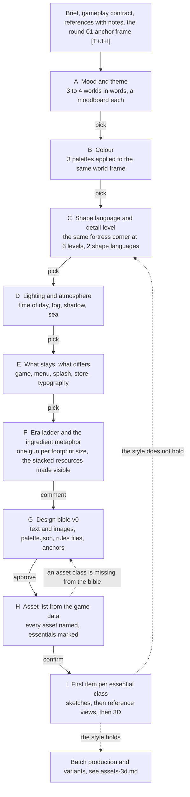

# Stage 01: Art direction, from mood to a design bible to an asset list

Goal: one visual identity, written down with text and images, that every asset, every screen and every store image inherits. Then a complete list of what the game needs, with the essentials marked, so production starts on the few items that settle the style and grows from them.

The order is cheap decisions first. Mood and theme in words cost nothing and steer every image after them. Colour comes before shape, because at 13 pixels colour reads when shape cannot. Shape and detail come before lighting. The rules for what stays the same across game, menu, splash and store come before any menu or store art. The era ladder for the cannon tiers comes before any advanced cannon. The bible comes before the asset list, the list before the first asset, so nothing is made twice.

Every phase ends in a pick by Sebastian, asked with the images open in his editor and linked, never from names alone. A round shows him at most 25 new images, and the agent may iterate past that count inside the round to get the sheet right, inside the session's spending cap (D19). Each phase lives in its own round folder, `game/art-direction/rounds/NN-<phase>/`, with the images, their sidecars, the contact sheet, the critiques and a `PICKS.md`. A phase can send one phase back. A global mismatch found later, in an asset or in the game, sends the bible back to the phase that owns the fault.

## Inputs

- [brief.md](../../game/art-direction/brief.md): the game, the constraints, the tone words, the game-design notes that shape the art.
- [gameplay_contract.yaml](../../game/art-direction/gameplay_contract.yaml): camera, tile size, pixel sizes, budgets.
- [inspirations/notes.md](../../game/art-direction/inspirations/notes.md): the references and what to take from each.
- The round 01 anchor frame, decision D15: the starting point for phase A, not its end.

## Phase A: Mood and theme

What the game feels like, in words first, then in images. Three or four candidate worlds, each a paragraph: the world in one sentence, the era mix, three tone words, what the player feels in the build phase and in the battle phase, the motifs that repeat, what it is not. Each candidate gets a moodboard of six generated images: a coast, the fortress from the gameplay camera, a harbour at another time of day, a battle moment, a close material study, a sky. The references condition the image model. A reference collage per candidate shows which Steam shots fit it.

Output: `rounds/02-mood/`, and the theme chapter of the bible in draft. Pick: one world, or a merge named in words. Cost: about 3 USD.

## Phase B: Colour

From the picked moodboard, three palette candidates. Each is a named swatch set: sea, sand, grass, stone, wood, iron, roofs, sky, fog, the four team colours, the UI accents. Each palette is applied to the same world frame by image editing, so the comparison is colour only. The edit moves each surface toward its swatch and does not hit the hex, so the swatch sheet is the palette and the frame is the impression. A crop scaled so a tile is 24.7 px wide, the tile width of the contract at the default view, with the tile width measured per frame with a ruler crop, shows whether the four team colours stay apart. Never scale by a wall: the anchor's fortress wall is two tiles tall.

Output: `rounds/03-colour/`, [palette.json](../../game/art-direction/palette.json). Pick: one palette, with corrections by swatch name. Cost: about 1 USD.

## Phase C: Shape language and detail level

The same fortress corner at three detail levels and in two shape languages, six images edited from a crop of the picked frame's fortress corner, upscaled so the bevel and the facets show: the levels are Kingdoms and Castles, River Towns and Foundation, the languages are rounded and chunky against faceted and sharp. With it a draft rule set in words: bevel width, facet size, silhouette rules, how many parts a building has, how much detail each tier may carry, what a wall shows at 13 pixels and what only at the zoomed view.

Output: `rounds/04-shape/`, `geometry_rules.yaml`. Pick: a level and a language. Cost: about 1 USD.

## Phase D: Lighting and atmosphere

First the full picked frame redrawn at the picked shapes of phase C, which is the noon variant and the base of the round. Then time of day, fog, shadow strength and the sea treatment as four to six relights of it. The pick sets the sun angle, the sky colour, the fog depth and the water style for the game and for every preview render.

Output: `rounds/05-light/`, `lighting_rules.yaml`, the world anchor image. Pick: one. Cost: under 1 USD.

## Phase E: What stays and what differs

A table with one row per surface: in-game world, in-game UI, menu, splash, store page, trailer still. Columns: palette, shapes, detail, lighting, composition, text. The game and the 2D surfaces share the theme, not the style: the store art, the splash and the menu are painted 2D illustrations, never edits of the game's render (D24). Study the capsules of comparable games before the first image.

The key art comes first, without text: broad rounds of painted candidates, then local fixes on the picked one, each fault pasted back through a mask so the rest of the picture stays. The subject and its rules come from Sebastian's comments and go into a checklist. Every line of the checklist is checked in magnified crops before an image is shown, and only passing images are shown. The title is then lettered on a flat green screen, keyed to a transparent logo, and judged on a capsule at real size, never on its own. A script composites the whole store set from the key art, a few repaints for other aspect ratios and the logo, see [marketing.md](marketing.md).

Output: the cross-domain chapter of the bible, the key art, the logo, `typography.yaml`. Picks: the key art and the title style. Cost: under 1 USD planned, round 07 to 15 spent about 14 USD, most of it on the key art.

## Phase F: Era ladder and the ingredient metaphor

The game stacks resources into bigger guns, and the big guns outgrow the age of sail. The ladder says how. Read the footprint sizes from the game data first: the ladder has one step per gun size, and each step gets an era. In Grid Cannons the sizes are 1, 2 and 3 tiles, so the steps are medieval and age of sail, bigger guns, and iron and early industry (D16, D28). Per step: materials, silhouette, how much detail is allowed. The resources the game gives, `upgrade_a` and `upgrade_b` in the data, need a visible form that stacks into the buildings. Candidates: wood, stone, iron, blocks of tools, gear sets, each a box of the same size.

Before any image, write the round's brief with Sebastian: what each gun must show, what the blocks must do in play, and which references set the style. His words go into the brief unchanged, and every sheet is checked against it before he sees it. A round that starts from the plan's assumptions instead is wasted, as round 16 was.

The sheets are painted concept sketches: loose brushwork in the bible's palette, in the style of the painted key art and the references, never an imitation of the low-poly render (D30). Attach the painted references, never the world anchor. Show several designs per gun size, so Sebastian can pick one per size. Sizes only need to read: guns of different sizes must not look alike, and a bigger gun is never the same model scaled up. An image model does not size objects to tiles, whether asked in words or given a block-out, so a sketch is never measured.

Output: the tier chapter of the bible, one picked gun design per size, the block candidates. Checkpoint: Sebastian picks. The mapping of blocks to resources and the first version of the upgrade tree are game-design decisions, taken after the simple cannons exist (D17). Cost: about 1 USD, round 16 spent about 5 USD on 19 sheets.

## Phase G: Design bible v0

[art_bible.md](../../game/art-direction/art_bible.md) with the chapters filled: theme, colour, shape, lighting, cross-domain table, era ladder, the do-not list. Every chapter carries its anchor image inline, from `anchors/`. Next to it the machine-readable files: `palette.json`, `geometry_rules.yaml`, `lighting_rules.yaml`, `typography.yaml`. Each downstream call gets the chapter it needs, never the whole bible.

Checkpoint: Sebastian approves v0. Tag the commit `bible-v0`. The bible is versioned: a change to a rule is a new version and a decision entry.

## Phase H: Asset list

[asset_list.md](../../game/art-direction/asset_list.md), derived from the game data, not from taste: every building in `data/buildings`, every wall shape and level, the tile, every nature kind, the ships, the projectiles, the effects, every UI screen, every store item. Columns: id, class, tier, priority, route, variants, status. Priority is essential, core, later or unsure. The essentials are the few items that settle the style: the tile, the four wall shapes, the base, the simple cannon, the ship, three nature kinds, the splash, the menu and the logo. Variants are named so the count is known: team colours, damage states, upgrade tiers, nature variants.

Checkpoint: Sebastian confirms the essentials and marks what he is unsure about, such as the shield. Items he marks unsure wait.

## Phase I: First item per essential class

For each class of the first batch (D33), in this order: sketches, three or four painted concept sketches of the item in the bible's palette and shapes, never in the render look (D30), Sebastian picks one, or several, which then become looks of the same id that the game picks at random (D38). An item with a picked design, such as the guns of D31 and the blocks of D29, skips this step. Then the reference: one side view on plain ground from the picked sketch by image editing, the input of the generative route. Then 3D through [assets-3d.md](assets-3d.md): a Meshy run, the cleanup by hand in Blender, the bench or the preview in the game, Sebastian's approval (D34 to D37). When the first item of a class holds the style in the game screenshot, the class goes to batch production and its variants are made from it. When it does not hold, phase C or D gets the fault.

## Where this stage ends

The bible is approved, the asset list is confirmed, and one item per essential class stands in the game and looks like the bible. From here [assets-3d.md](assets-3d.md), [assets-2d.md](assets-2d.md) and [marketing.md](marketing.md) run in parallel on the bible, and [integration.md](integration.md) checks them together.
