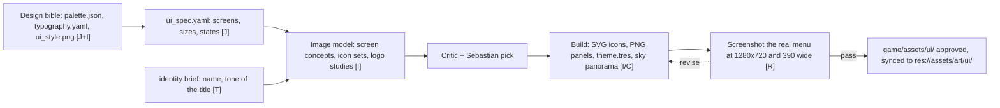

# Stage 02B: In-game 2D and identity

Goal: menu, splash, HUD, icons, the title and type system, and the world background, all from the design bible. Output: files Godot loads through a Theme resource and a few textures.

## What the game needs

Measured in the survey of the game repo, see [grid-cannons.md](../grid-cannons.md).

| item | now | target |
|---|---|---|
| main menu | dark ColorRect, buttons made in code with the default theme | background image, Theme resource, title treatment |
| splash | none | one scene, one image, the logo |
| loading screen | a bar on a dark panel | one piece of concept art at random behind the bar, from the anchors through `storeset.py loading` (D65) |
| HUD and sandbox UI | built in code, default theme | the same Theme resource |
| icons | none | one icon per building type, readable at 32 px |
| world background | none | one panoramic sky image for a PanoramaSkyMaterial |
| title and type | a Label with text CANNONADE at size 44 | a logo image and typography.yaml |

## Inputs per call

- Screen concept: the UI spec for that screen, `ui_style.png`, `palette.json`. The image model paints the whole screen as a picture. It is a concept, not the build.
- Icon set: one prompt for the whole set so the icons match. White on transparent or one flat colour, then recolour from the palette in code.
- Logo: the name, the tone words, three contrasting type directions. Pick one, then vectorise or rebuild it as SVG so it scales.
- Sky: the world style anchor and the lighting rules. Equirectangular, 4096 by 2048.

## Build

The build step turns concepts into files Godot can use. Panels and buttons become 9-slice PNGs or StyleBoxFlat values in `theme.tres`. Icons become SVG. The concept image is never shipped as the UI.

## Acceptance

A screenshot of the real menu scene in Godot at 1280x720 and at 390 pixels wide. The critic checks legibility, contrast against the palette, and whether the screen and a world screenshot belong to one game. Sebastian approves the first version of each screen.
