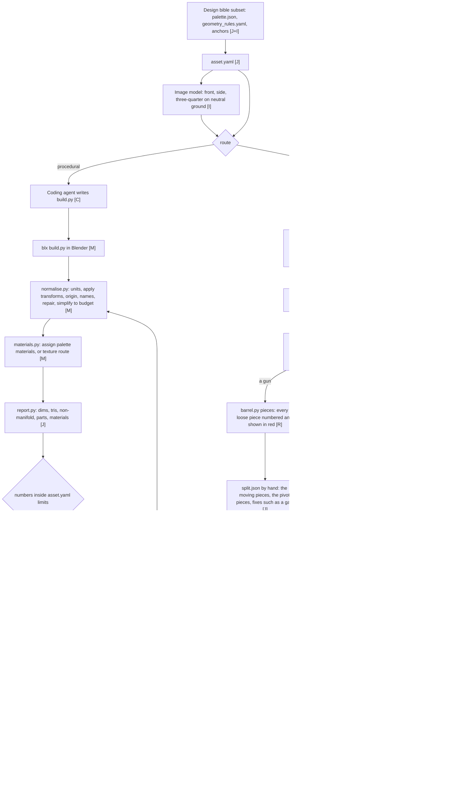

# Stage 02A: 3D world assets

Two routes make geometry. Procedural is the default for exact modular pieces such as walls and tiles (D4). Generative comes first for the guns and other complex silhouettes, where a script building part by part is the last resort (D34). The generative route runs on Meshy (D36), and a cleanup by hand in Blender is part of it every time: no generated model goes into the game without it.



## Which route

| asset class | route | reason |
|---|---|---|
| straight walls, corners, crosses, damaged states | procedural | exact modular dimensions, interchangeable states |
| cannons, merged guns, flak, rocket, shield | generative on Meshy, cleanup by hand in Blender (D34, D36, D37) | an artillery piece can look complex. The barrel still becomes a separate part on the trunnion pivot, every gun stands on a square plate (D39) |
| supply depot, resource blocks, the base | generative on Meshy, cleanup by hand with cleanup.py (session 07) | the painted designs carry their props and colours into the model, a script would redraw them |
| towers, simple buildings | procedural, or hybrid | repeated geometric structure |
| rocks, coast decoration | either, compare in C4 | irregular shapes. C4 picked Tripo for boulders (session 08); the verdict covers boulders |
| trees, bushes, grass | procedural | cheap stylised geometry, many instances. Session 08 put them on image-to-3D anyway and got clusters of flat leaf-card planes (D45). Session 09: the builder paints the texture itself (D49), flat palette bands are gone |
| ships, statues, ornate props | generative, then Blender | complex silhouette |

The table is binding. A session plan overrides it for a class only with a decision entry, and only after one asset of that class was built and gated on the new route. A pick made in a route comparison covers the class it was compared on.

Hybrid: generate the ornate shape, import it, then rebuild a clean low-poly version from primitives with the generated mesh as the silhouette reference.

## The generative route, step by step

This is how the three guns of the first batch were made (round 18, D37). The next generated asset follows the same steps.

1. **Reference.** Start from the painted sketch Sebastian picked. Make one side view of the item on plain light grey by an image edit with `nano-banana-2.1/edit`, the sketch attached, the same design, parts and colours, no shadow, the item filling 70 to 90 percent of a 1,024 px frame. Check the view in a magnified crop against the sketch before any 3D run. A three-quarter view works for compact items but shortens a long barrel on Meshy's low-poly model.
2. **Generate.** `mesh.py meshy` with `model_type=smart-topology`, `ai_model=meshy-t2` and a `target_polycount`. One image is enough; more views only help on `meshy-7.1`, which fuses the parts. For a new class, run a ladder of counts and let Sebastian pick from [meshsheet.py](../../pipeline/meshsheet.py) and the Godot bench. The guns use about 1,000, 1,500 and 3,000 triangles from small to large.
3. **Look at the pieces.** `barrel.py <asset> pieces <run>` numbers every loose piece of the model and shows each one in red, with the automatic barrel in blue. The automatic choice is only a start: in round 18 it put bolts, pins, trunnion stubs and housing plates on every barrel.
4. **Write `split.json` by hand.** In the asset folder: the source run, the numbers of the pieces that move with the barrel, the numbers of the pivot pieces (the pin, the trunnion stubs or the ball, whose centre becomes the pivot), and fixes. A fix changes pieces: `raise_top` lifts a post's top to the yoke above it, `lift` raises pieces and stretches a neck under them, `shorten` shrinks a barrel along its own axis, `drop` deletes pieces that do not belong (a cradle Meshy floats off the barrel it should carry), and `slot` subtracts an axis-aligned box from a piece (a fork head solid across the middle that the barrel must roll through: `{piece, x: [lo, hi], y: halfwidth, z: [lo, hi]}` in the normalised frame). Record why next to each fix and which pieces belong to the body. Two keys cover parts that are not a level barrel. `pitch` gives the degrees a moving part points up in the source, such as the mortar at 45, and the build levels it about the pivot, because the game sets the tilt. `part: guns` names a part the game aims by its whole orientation, such as the flak's cluster: it gets no `projectile_spawn` and keeps its pitch as its rest pose.
5. **Build.** `barrel.py <asset> final` writes `final.glb` and `source.blend` into the asset folder: the mount, the barrel with its origin on the trunnion axis tilting about its X axis, the muzzle pointing to −Z in Godot, an empty `projectile_spawn` at the muzzle (the `HAND_SPAWN` table in [blender/barrel.py](../../pipeline/blender/barrel.py) holds Sebastian's hand placements, taken by dragging the empty in a `tools/spawn_place_<gun>.tscn` scene that instances the built glb; guns without an entry fall back to the bore-mouth search), the texture at 1,024 px in JPEG, and the `plate` of `split.json`: a square under the gun in the gun's grey, the footprint less 5 cm per side, which the game keeps square to the grid while the gun turns (D39). The mount, not the whole gun, is centred on the plate. The build then scales the gun until the mount and the moving part stay inside the plate, 2 cm short of its edge, at every turn and tilt the game gives them: a barrel from -10 to 90 degrees, guns from level to straight up (D61). asset.yaml names the plate as `pivots.anchor`. [align.py](../../game/art-direction/rounds/27-indicators/align.py) checks the built glb, mount centre minus plate centre under 0.02 m, and [contain.py](../../game/art-direction/rounds/28-advanced-buildings/contain.py) checks the reach against the plate.
6. **Check.** The final sheet shows the barrel 10 degrees down and 45 up, or guns level and at 80. Nothing may stay behind or float when the part moves, and nothing may pass through the mount at any tilt the game uses: measure that on sampled points before judging a render, because an overlap in projection looks like a clip. Every fix is checked in magnified crops of the same region before and after.
7. **Bench.** Copy `final.glb` into [tools/gun_test/models/](/home/womb/repos/grid-cannons/tools/gun_test/models) in the game repo. Sebastian turns the gun and tilts the barrel by hand in [tools/gun_test.tscn](/home/womb/repos/grid-cannons/tools/gun_test.tscn). A fault goes back to step 4.
8. **Report and approval.** `asset.py <asset>` reads the `asset.yaml` of a generative asset, imports `final.glb`, writes `report.json`, the render sheet and `manifest.json`. After Sebastian's pass, `asset.py approve <asset>` records it, and [godot_sync.py](../../pipeline/godot_sync.py) copies the model into the game.

A model that does not move, such as a block, a depot or the base, skips the barrel steps 3 to 7. Its `cleanup.json` names the source run, the part name, the turn that brings the front to −Y (the side the gameplay camera sees), the size (`size` for exact dimensions, `fit` for the longer side of the footprint with the proportions kept), and `team` for the base, plus `team_deck` for a flat roof without its own colour, such as the deck inside battlements (D42). [cleanup.py](../../pipeline/cleanup.py) `--raw` renders the run from four sides to choose the turn, then without it writes `final.glb` and `source.blend`, with the texture scaled to 512 px in JPEG. A `paint` spec in the same file (`kind`, `seed`) replaces a raw provider texture with the D49 painted path, deterministic from the seed, with a forced cube UV so the bands land by height; `keep_slots` keeps the `team` slot first for the runtime paint (C14, the castle states). A `paint` spec of `kind: flat` with `keep_uv: true` (D93, the castles) goes further and replaces the texture itself with one solid material a part, read from the source texture's own colours: `team` first (the game paints it in the player's colour), then `stone`, `dark` and `stone<n>`; the flat painter owns the team split, so the job's `team` flag only feeds it the team hue. Step 8 follows, and the check is a battle screenshot in the game instead of the bench.

Lessons from session 07:

- **Roofs are flat planes in the reference.** Meshy models raised, curved roof tiles at 550 triangles as spikes with holes between them. A reference that paints the tiles as a pattern on two flat planes came out clean on all four depots.
- **A compact item gets a three-quarter view.** The blocks and the buildings show their top and two sides in one image, a side view hides the top.
- **The team colour is split by the texture.** `team: true` moves every face whose texture is royal blue to a first material of its own, flat white, which the game paints in the player's colour. Samples sit inside each face, away from the UV island edges, where the texture bleeds.
- **The team part must read at the default view.** A roof does, a flag and a banner alone do not.
- **Textures are scaled and stored as JPEG.** Meshy returns 2,048 px PNG textures, 2.3 MB for one gun. At 1,024 px for a gun and 512 px for the rest, in JPEG at quality 90, the first batch takes 1.5 MB instead of 11 MB in the browser build, with no change a 2x crop of the closest zoom shows.

Lessons from session 08:

- **Foliage comes back as card clusters.** The image-to-3D models represent a bush as intersecting flat planes meant to carry a transparent leaf texture. The Tripo v2.5 endpoint takes no prompt text, the image is its only input, so no wording changes the structure. Bushes and trees are procedural (D45).
- **JPEG export strips alpha.** The cleanup stores textures as JPEG, which has no alpha channel, so even a provider that paints transparent leaves loses them at export. A design that wants transparency is a route smell for this game's solid geometry, not an export bug.
- **A route verdict covers its class.** C4 compared procedural against image-to-3D on boulders and Tripo won. Applying that pick to bushes and trees was the error that cost the session its nature gate.

Both APIs set the face count by a parameter, not by the prompt. [mesh.py](../../pipeline/mesh.py) runs either one and writes the sidecar with the credits charged and the time taken. Every export is a `.glb`, never an `.fbx`. The critic of the acceptance ladder runs on this route too: its prompt quotes the requirement's own words and names the failure classes of the shape kind, and its sheet includes the wireframe view.

| | Tripo, API v2 | Meshy, API v1 |
|---|---|---|
| use | simple shapes only, until its credits are spent (D36) | the game's models (D36) |
| one image | `image_to_model`, model `v3.1-20260211` | `image-to-3d` |
| several views | `multiview_to_model`: 2 to 4 files in the order front, left, back, right. Front is required, a missing view is left empty | `multi-image-to-3d`: 1 to 4 images, the first is the main view |
| low-poly mode and face count | `smart_low_poly` with `face_limit` 1,000 to 20,000. Returns 1.3 to 2.3 times the count asked | `model_type: smart-topology`, `ai_model: meshy-t2`, `target_polycount` 100 to 15,000, within 11 percent. Single image only |
| parts | `generate_parts`, only without a texture and without `smart_low_poly` | `meshy-t2` returns the parts as loose pieces of one mesh |
| price | 0.01 USD per credit, bought on the API platform apart from Tripo Studio. 40 credits per run | the plan's credits work for the web app and the API. 15 credits per textured `meshy-t2` run, 30 per multi-view run |

What the providers and other users recommend for the input: separate files for separate views, never one sheet, because a sheet reads as several objects. The same scale, framing and even light in every view, a plain background, 1,024 px or more. Clearly different angles. Side views made by an image model can disagree with the front and bend the mesh.

The route test of session 06 ran the three guns through both APIs with every input and method. Its results and verdicts are in [round 18](../../game/art-direction/rounds/18-gun-3d/RESULTS.md).

Lessons from session 16:

- **The reference repaint drifts tall.** Both castle reference views came out with a height-over-width ratio near 1.0 against the D68 rule of at most half, whatever the prompt said. The picked sketch's ratio is measured, the repaint is squashed to it as a free post step recorded in the sidecar, and Meshy follows the result closely: both first meshes were as tall as their reference told them to be. A keep a touch over the rule is squashed to `size` in cleanup.json rather than regenerated.

Lessons from session 12:

- **A gun the game aims whole needs the anchor's orientation.** The flak's `Guns` anchor is turned by replacing its whole basis, so a part posed pitched up aimed that far above every target until the art layer gave the anchor the part's rest orientation. Its anchor was also a placeholder mesh, which the art layer hides, and the art under it vanished. Probe a new anchor in the game before any board: visible, and aimed at a test point.
- **The critic's clipping claims need numbers.** On round 28 Gemini named ten faults and one was real. A clip seen in a render is an overlap in projection until a measurement on sampled points, or a part's lowest point against the part below, says otherwise. A nearest-face inside test is useless on Meshy meshes, whose open seams and flipped faces put points a metre "inside".
- **Raised roof tiles survive the prompt.** Both depot sketch boards painted raised tiles though the prompt asked for flat planes. The flat-roof edit of the reference view stays a step.
- **Random looks hide some looks in a battle.** A battle draws one look per building, so the gate shoots several `--artseed` values until every look has a frame.

## The asset contract

Every asset is one folder under `game/assets/3d/<asset_id>/`.

```text
game/assets/3d/cannon_basic/
├── asset.yaml       the contract below
├── refs/            reference images with sidecar JSON
├── build.py         procedural route: the script that makes it. Parameters at the top. `build:` in asset.yaml
│                    points at a shared script instead, such as ../wall_cornice.py for the eight walls of one look
├── raw/             generative route: the API output as downloaded, with sidecar JSON
├── split.json       generative route, a gun: the cleanup by hand for barrel.py
├── cleanup.json     generative route, a model that does not move: the cleanup by hand for cleanup.py
├── source.blend     editable result after normalisation
├── final.glb        what the game loads
├── previews/        sheet.png, gameplay.png, turntable.mp4 if made
├── report.json      the geometry report of final.glb
└── manifest.json    route, hashes, steps, limits, cost_usd (the sum of the sidecars), critic verdict, approved by, date
```

```yaml
asset_id: cannon_basic
route: procedural          # or generative, or hybrid
class: building            # wall, building, nature, terrain, prop
dimensions:                # metres, the game uses 1 unit = 1 metre
  max_x: 1.3
  max_y: 2.0
  max_z: 1.1
budget:
  max_tris: 600
  max_materials: 3
parts:                     # separate objects, named exactly like this
  - barrel
  - carriage
  - wheels
pivots:
  origin: ground_centre    # tile_centre for walls and centre for projectiles keep the build's own origin
  barrel: trunnion_axis
materials:                 # names from palette.json
  barrel: iron_dark
  carriage: wood_warm
  wheels: wood_dark
variants: []               # parameter sets for build.py, e.g. damaged, team_b
```

Variations change parameters in `build.py`, not the whole asset. A colour change never needs a new mesh. A second look of the same game id is its own asset folder with a number after a dot, such as `supply.2`, and the game picks one look at random for each instance.

## The normaliser

Every mesh, whatever its origin, goes through the same steps in [pipeline/blender/normalise.py](../../pipeline/blender/normalise.py):

1. Import, or take the scene the build script left.
2. Apply scale and rotation. Non-uniform scale breaks booleans and physics.
3. Set the unit to metres and the dimensions to the contract.
4. Put the origin where asset.yaml says, ground centre by default.
5. Name objects as the parts list says. Remove everything else.
6. Repair: merge doubles, recalculate normals, count non-manifold edges.
7. Simplify to the triangle budget. Generated topology never ships as it arrives. Keep the high-poly source in `raw/` if a bake is needed later.
8. Save `source.blend`.

## Materials

| approach | method | for |
|---|---|---|
| flat palette | [materials.py](../../pipeline/blender/materials.py): one material per palette key, flat shaded, named after the key. asset.yaml maps each part to a key of palette.json or a hex | walls, the tile, the cannonball (default, D5) |
| vertex colours or palette atlas | per-face variation, no unique texture | rocks, terrain, props |
| generated or painted textures | base colour, optional normal and roughness, fresh UVs | hero assets only, if B6 decides textured |

No baked lighting in albedo. The game lights the scene.

## Acceptance

Numbers first, pixels second, screenshots last (D9).

1. `report.json` inside every limit in asset.yaml: dimensions, triangles, materials, zero non-manifold edges, parts present and named, and `solidity` against `min_solidity` where the kind sets it.
2. The wireframe view `5_wire.png`, judged magnified. A closed solid and a cluster of flat planes are told apart at a glance in the wire; matcap and texture views can hide it, and did (session 08 bush gate miss).
3. The 4-view matcap sheet, 640 pixels wide, plus one render from the gameplay camera at the on-screen size the gameplay contract gives. Matcap shows the flat base colour, never the texture, and the gameplay view is a few pixels tall; the textured view `6_texture.png` (EEVEE, game light, magnified) is the preview of the material itself.
4. The critic gets the sheet, the report and asset.yaml. It returns pass, or a numbered list of corrections with the feedback level (asset, domain, global). Its prompt quotes the requirement's own words, from asset.yaml or the decision, and names the failure classes of the shape kind; a silhouette verdict alone never gates a mesh.
5. Sebastian sees the sheet of every new asset class once. Repeats of an approved class pass on the critic alone.
6. A claim about placement or shape on the ground is measured straight from above in the placed game, never judged in an oblique frame: a centre against a centre, a width against a height. For a gun that is mount minus plate under 0.02 m after it stands in its tile (`tools/shoot_battle.gd --align` prints it), every part inside its plate at every turn and tilt, and a ring round it at width/height 1.00. Round 27 lost four attempts to eyeballed oblique boards and to a gate that measured the model instead of the placed game.
7. The gate board shows the asset big, always (D48). Painted and render views full width or near it, close-ups of the part under judgement, in-game crops magnified 3x or more. Tiny game graphics on a board are a rejected board: "Show me bigger versions of the ship, not just tiny game graphics. That goes for all assets!"
7. The asset must hold up zoomed in, because the game gets played zoomed in: "The game needs to look decent zoomed in." Inspect every part magnified, up close, from more than one angle, before the board is built; a fault invisible at gameplay size is still a fault.

The asset counts as approved when `manifest.json` has the critic verdict, the approver and the date.

## Lessons from the first run (session 01)

- Axes: `asset.yaml` dimensions are Blender axes, Z up, metres. `export.py` writes the `.glb` with Y up, which is what Godot expects. The game wrapper lifts the asset 0.1 m onto the slab top.
- Build a part as one mesh. Joining boxes leaves interior faces, and the report flags them as non-manifold edges. Extrude a profile with bmesh, or clean the join with a boolean.
- Blender's Python has no YAML and no PIL. `asset.py` parses the contract on the `uv` side and prepends it as Python literals. Image composition stays outside Blender.
- The pixel sizes in the gameplay contract were confirmed by the Godot screenshot of the first wall to within 2 px.
