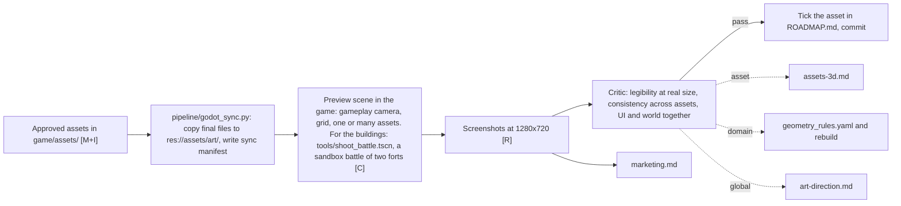

# Stage 03: Integration in the game

Goal: every approved asset seen in Grid Cannons from the gameplay camera, next to the other assets, before it counts as done. Output: gameplay screenshots that feed the marketing stage and the cross-domain review.

## The art layer in the game

The game repo gets one folder, `res://assets/art/`, with `3d/`, `ui/` and `sky/`. [scripts/Art.gd](/home/womb/repos/grid-cannons/scripts/Art.gd) in the game attaches `3d/<id>.glb` to the prefab with that id, maps snake_case parts to PascalCase pivots, hides the placeholder meshes and checks the size against `manifest.json` once. More looks of one id, `3d/<id>.2.glb` and on, are picked at random per building. A wall asks for its shape and level, `wall_line_base` for every slot of the straight lower wall, so one look fills all slots. Swapping art means replacing files, not editing scripts. The contract and the wiring changes are in [grid-cannons.md](../grid-cannons.md).

## Sync

[pipeline/godot_sync.py](../../pipeline/godot_sync.py) copies `final.glb`, the UI files and the sky image from [game/assets/](../../game/assets) into the art layer and writes `res://assets/art/manifest.json` with the asset id, the source manifest hash and the date. It copies only assets whose `manifest.json` says approved, which `asset.py approve` records after Sebastian's pass. It writes a minimal `.import` next to each model, so Godot keeps a generated model's texture inside the `.glb`. It never touches anything outside `res://assets/art/`.

## Regression

A change to the design bible regenerates assets. After a batch, the preview scene shows the whole set in one screenshot. The critic compares it with the last approved screenshot of the set and names what moved. The screenshots live in `game/assets/marketing/gameplay/` with the date in the name.

## Feedback levels

| level | sign | fix lands in |
|---|---|---|
| asset | one asset is off | its asset.yaml or build.py |
| domain | one class is off against the others | geometry_rules.yaml, then rebuild the class |
| global | the game looks like several games | the design bible, then decide which consumers regenerate |
