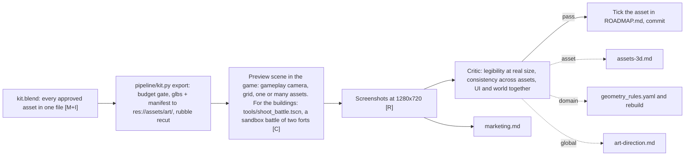

# Stage 03: Integration in the game

Goal: every approved asset seen in Grid Cannons from the gameplay camera, next to the other assets, before it counts as done. Output: gameplay screenshots that feed the marketing stage and the cross-domain review.

## The art layer in the game

The game repo gets one folder, `res://assets/art/`, with `3d/`, `ui/` and `sky/`. [scripts/Art.gd](/home/womb/repos/cannonade/scripts/Art.gd) in the game attaches `3d/<id>.glb` to the prefab with that id, maps snake_case parts to PascalCase pivots, hides the placeholder meshes and checks the size against `manifest.json` once. More looks of one id, `3d/<id>.2.glb` and on, are picked at random per building. A wall asks for its shape and level, `wall_line_base` for every slot of the straight lower wall, so one look fills all slots. Swapping art means replacing files, not editing scripts. The contract and the wiring changes are in [grid-cannons.md](../grid-cannons.md).

## Sync

[pipeline/kit.py](../../pipeline/kit.py) export ships the game's 3D from [kit.blend](../../game/assets/3d/kit.blend), the one Blender file holding every asset as a collection (D95). The kit has two roots, `kit` for what the game plays and `parked`, excluded from the view layer, for what a manifest parks; a family with damage stages is one group a look with the stages nested inside (`castle.3` holds `castle.3.d0` to `castle.3.d4`), so a castle and its ruins sit together (D101). An asset enters the kit when its pipeline step finishes (`kit.py build` folded them all at first; `kit.py add <id>...` re-folds one asset after a rerun or a hand edit in Blender, placed by its manifest). Export derives each game id from its collection name, gates on the art manifests' approved and parked flags, prunes a parked asset's glb, rubble and manifest entry from the game, re-checks each asset's budgets from its `asset.yaml` fresh in Blender, writes `res://assets/art/3d/<id>.glb` with a minimal `.import` and the `manifest.json` entry with the axes swapped to Y up, and re-cuts the rubble models from the shipped glbs through [fracture.py](../../game/assets/3d/fracture.py). The UI files and the sky image still copy by hand from [game/assets/](../../game/assets). The per-asset `source.blend` and `final.glb` are pipeline intermediates, not kept in the repo: a rerun regenerates them and `add` folds the result back into the kit.

## Regression

A change to the design bible regenerates assets. After a batch, the preview scene shows the whole set in one screenshot. The critic compares it with the last approved screenshot of the set and names what moved. The screenshots live in `game/assets/marketing/gameplay/` with the date in the name.

## Feedback levels

| level | sign | fix lands in |
|---|---|---|
| asset | one asset is off | its asset.yaml or build.py |
| domain | one class is off against the others | geometry_rules.yaml, then rebuild the class |
| global | the game looks like several games | the design bible, then decide which consumers regenerate |
