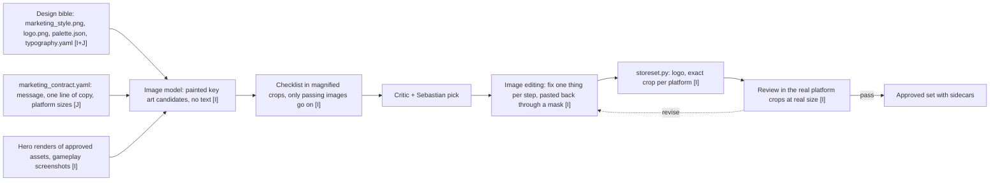

# Stage 02C: Splash, cover and store art

Goal: key art, a splash image, store capsules and screenshots that share the world's shapes, colours and motifs, with more drama than the world itself. Output: [game/assets/marketing/](../../game/assets/marketing).

## Order

Marketing concepts can start as soon as the design bible is v0. Final store files wait until a working game scene exists, because they use real gameplay images and the real logo.

## Inputs per call

- Key art: the message in one sentence, the composition idea, `marketing_style.png`, two or three hero renders from `game/assets/3d/*/previews/`, one gameplay screenshot. The renders anchor the shapes so the key art shows the same cannons the player sees.
- Compositing: never by an image model. A script places the logo and copy at exact pixel positions and writes each platform size. Text in generated images is not trusted.

## Platform sizes

Write the target list in `game/assets/marketing/marketing_contract.yaml` when the platform is chosen. [storeset.py](../../pipeline/storeset.py) already makes every Steam capsule, the Steam library set, the itch.io cover, a 512 icon with an .ico and the 1920 by 1080 splash, each at its exact size. Only the title is text, and the library hero and the page background carry none.

## Legal

Cannonade, the project Grid Cannons, is a new game in the spirit of Rampart. No Atari logo, title treatment, box art or sprite enters a prompt or an output. Inspiration images from the original stay out of the repo.
