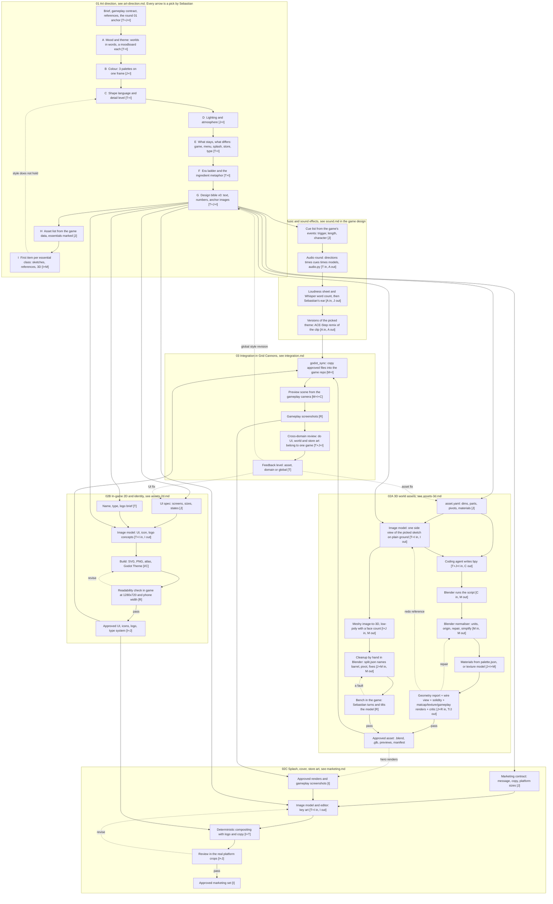

# The production process

One shared creative direction feeds four production lines. This page holds the master graph. Each stage has its own page with the detailed chart, the inputs every model gets, and the acceptance test.

**This chart is the process.** When a session changes how we make something, it changes the chart in the same commit and adds a line to [process-log.md](../process-log.md).

## Layers

1. **Art direction**: mood, colour, shape, lighting, the cross-domain rules and the era ladder, each picked by Sebastian, written into a design bible of text and images, then an asset list with the essentials marked, then the first item per essential class. [art-direction.md](art-direction.md)
2. **The design bible**: [art_bible.md](../../game/art-direction/art_bible.md) with the rules files and anchor images next to it in [game/art-direction/](../../game/art-direction). Every production line reads its chapter of the bible.
3. **Production lines**: 3D world assets [assets-3d.md](assets-3d.md), in-game 2D and identity [assets-2d.md](assets-2d.md), marketing art [marketing.md](marketing.md).
4. **Integration**: assets tested together in the game from the gameplay camera. [integration.md](integration.md)
5. **Feedback**: a failure returns to the asset, to the domain rules, or to the shared kit. Which level is a judgement the critic makes and the human confirms.

## Legend for every chart

| mark | data that flows |
|---|---|
| T | text: briefs, prompts, critiques |
| J | structured values: JSON and YAML |
| I | image: PNG, JPG |
| M | mesh or scene: .blend, .glb, .obj |
| C | code: Blender Python, GDScript |
| R | render or screenshot |
| A | audio: WAV, MP3, OGG |

Solid arrows are handoffs. Dashed arrows are feedback or optional reuse.

## Master graph

## What each model gets, and what comes back

Text and numbers carry intent, dimensions, constraints, colour values and technical limits. Images carry what numbers cannot: shape language, atmosphere, composition. Meshes carry geometry and construction. Renders let a critic see the result under real viewing conditions. No one of these replaces another.

| step | the model gets | the model returns |
|---|---|---|
| Creative exploration | T: premise, tone, mechanics, gameplay contract. I: inspirations | 3 to 6 written directions, each with prompts |
| Style frames | T: one direction prompt. I: optional inspirations | several images per direction |
| Direction critique | T: brief and criteria. I: all candidates together | strengths, faults, a ranking, a recommended edit per image |
| Asset reference | T: asset description, dims, shape rules. I: approved anchors | front, side, three-quarter views on neutral ground |
| Procedural 3D | T+J: asset.yaml, geometry rules, palette. I: references | Blender Python, then an editable .blend |
| Generative 3D | I: isolated references. J: the API parameters it supports | raw .glb or .obj, optional textures |
| Blender repair | M: the asset. T+J: spec. I: reference and review renders | corrected .blend and .glb |
| Materials | J: palette and material rules. I: texture references. M: when the API needs it | material assignments or texture maps |
| 3D critique | R: 4-view sheet and gameplay view. J: geometry report. J: asset.yaml | pass or a structured correction list |
| In-game 2D | T+J: purpose, sizes, states. I: approved anchors | SVG, PNG, atlas |
| Key art | T: message, composition, brand rules. I: anchors, renders, screenshots | key art, splash, background |
| Store assembly | T+J: copy, exact sizes. I: key art, logo | composited store files |

A mesh API reads one image and a few numbers. It cannot read the art bible. The upstream image step must put the art direction into the reference image. A coding agent reads text and images, so it gets explicit rules.

## Where the agentic process leaves the human one

The human order is mood, concept art, model sheet, mesh, texture, integrate. We start from it and test where cheap code and cheap meshes let us cut or reorder. Roadmap item H1 tests whether the 2D reference stage pays for itself on low-poly procedural assets. H2 tests variations of a finished asset in place of prototypes. Results go into [process-log.md](../process-log.md) and change the charts here.

## Feedback levels

- **Asset**: the cannon wheels are too small. Change the asset parameters or the mesh.
- **Domain**: every cannon has more detail than every wall. Change geometry_rules.yaml and rebuild the dependent assets.
- **Global**: UI, world and store art look like three games. Revise the design bible, then decide which consumers regenerate.
