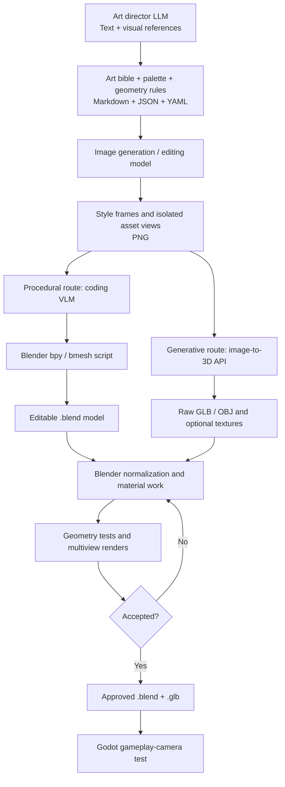
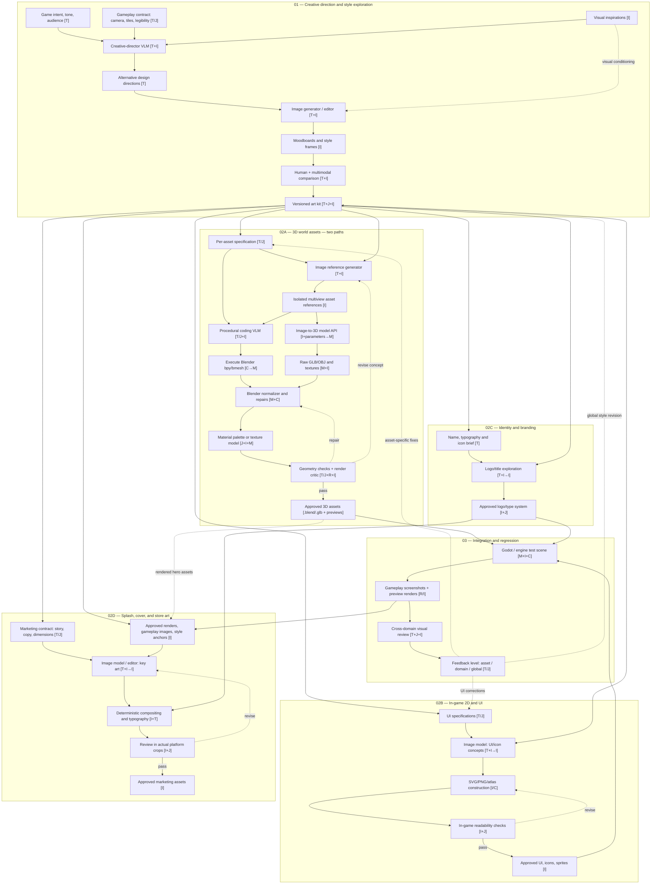

# AI-Native Design and Game-Art Production: Full Conversation

*A Markdown transcript of our conversation about redesigning the web-design process around AI, from creative direction to image-generation feedback loops. The original visual cards and diagrams have been rendered as Markdown text; linked illustrations are described rather than embedded. Model and product claims are preserved as discussed, not independently re-verified for this export.*

---

## 1. Starting question: An AI-first portfolio design process

### User

I want to make a.portfolio site.wih my picture, video my project amd contacts...

I am taking this as an opportunity to get better at ai design.
Ai makes fine react pages, but i usually just tell it a layout and theme. With humans i would let a designer make a design tempkate and a few mockups first... Make a final design and then implemt. That approaxh probably improves results with ai also. Is rhat so? What tools wouls i use how does mynprocess look like? No clue whats best for pyre design and protoypes and how to make it so the coding ai has the best possible temate it can actually understand. To beclear: I want to use all ai toolas for all design phases.

### Assistant

**Yes. Separating AI design from AI coding is likely to produce much better results**, especially if your goal is a distinctive portfolio rather than another generic AI-generated React website.

Your intuition about human designers is correct. A good designer doesn't immediately start implementing a page. They explore ideas, compare visual directions, develop a coherent design language, create mockups, and refine the experience before development.

You can reproduce almost that entire process with AI.

The important distinction is that you want **AI acting as a designer first, and an engineer second**.

#### 1. The AI-first design workflow I'd recommend

```text
01 · Creative brief
     ChatGPT / Claude
     Goals, audience, personality, content
           ↓
02 · Visual exploration
     Google Stitch / Figma AI
     3–5 radically different design directions
           ↓
03 · Final design system + mockups
     Figma / Stitch
     Typography, colors, layouts, mobile designs
           ↓
04 · Interactive prototype
     Figma Make
     Navigation, transitions, video, interactions
           ↓
05 · React implementation
     Cursor / Claude Code / coding agent
     Design references + structured specifications + assets
           ↓
06 · Visual QA
     Coding agent + browser screenshots
     Compare implementation against approved designs
```

The biggest improvement over ordinary prompting comes from three things:

- **Exploration:** The AI generates genuinely different creative concepts before you commit to one.
- **Design consistency:** Typography, spacing, colors, and component rules are established before implementation.
- **Handoff fidelity:** The coding AI receives more than a screenshot. It receives an actual design specification and, where possible, structured design data.

#### 2. Which tools should you use?

These are the tools I'd actually consider in October 2026.

- **[Google Stitch](https://stitch.withgoogle.com/) — Visual exploration.** My first choice for ideation. AI-native design canvas for generating multiple polished UI directions from descriptions, images, and references. Particularly useful for experimenting before writing code.
- **[Figma AI](https://www.figma.com/) — Final design.** My choice for handoff. Its AI agent can generate and edit native design elements. Crucially, Figma's MCP integration lets coding agents read actual components, variables, and layout information.
- **[Figma Make](https://www.figma.com/make/) — Interactive prototypes.** Converts designs and prompts into working interactive experiences. Useful for testing navigation, hover behavior, transitions, and responsive layouts before committing to your actual implementation.
- **[v0 by Vercel](https://v0.app/) — Alternative rapid prototyping.** Great when you prefer designs that are already close to code. Supports Figma imports and image references. I'd use it for quick implementation experiments, not as my main design system authority.

You don't need all four. For learning a disciplined process, I'd start with **ChatGPT → Stitch → Figma → coding agent** and add Figma Make only when interaction design becomes important.

#### 3. What each design phase should produce

##### Phase A — Creative direction

Before asking AI to design the portfolio, have it act as a creative director.

Tell it who you are, what sort of work you do, and what feeling visitors should get.

For example, you could explore these very different directions:

| Direction | Character |
|---|---|
| Editorial | Minimal, refined, typography-led |
| Experimental | Bold, energetic, unconventional |
| Cinematic | Immersive, visual, atmospheric |

*The original conversation displayed visual references for these styles, not proposed final templates.*

Your AI should be asked for **contrasting concepts**, not three minor variations of the same layout.

A good creative exploration should produce:

- Three visual directions with distinct personalities.
- A moodboard or visual reference set for each.
- A short design rationale explaining typography, composition, color, and motion.

##### Phase B — AI-generated mockups

Take your preferred directions into Stitch.

Generate desktop and mobile mockups using your *real* portrait, project images, and video thumbnails wherever possible.

For your portfolio, I'd ask for at least four screen types:

1. Homepage with your portrait and introduction.
2. Project gallery with prominent visuals.
3. Individual project detail page, including video.
4. Contact section or page.

Don't polish everything yet. Compare the designs as a complete portfolio, not only their hero sections.

##### Phase C — Create the final design specification

This is the phase most AI-assisted workflows skip.

Before coding, tell your design AI to formalize its decisions:

| Deliverable | What it specifies |
|---|---|
| Design tokens | Exact colors, fonts, type scale, spacing |
| Components | Buttons, navigation, project cards, video player |
| Layout specifications | Grids, widths, padding, breakpoints |
| Responsive designs | Desktop, tablet, mobile behavior |
| Motion specifications | Transitions, timing, hover, scrolling |
| Assets | Photos, videos, icons, thumbnails |

Google's Stitch supports an open `DESIGN.md` format specifically for communicating design rules and intent across tools.

For example, a design specification might contain:

| Example design token | Value |
|---|---|
| Palette | `#111111`, `#F5F1E8`, `#D6FF47`, `#777777` |
| Heading font | Space Grotesk |
| Body font | Inter |
| Content width | 1280px |
| Spacing scale | 8px base |
| Project card radius | 4px |

*These values are illustrative.*

This makes the eventual coding AI significantly less reliant on guessing what you intended.

#### 4. The most important part: Getting the design into the coding AI

This is where I'd invest the most effort.

There are three levels of handoff quality:

1. **Level 1 — Screenshots.** The AI visually interprets the design and tries to reproduce it. Easy, but spacing, fonts, responsive behavior, and detailed styling can drift.
2. **Level 2 — Screenshots + `DESIGN.md` + assets.** Much better. The model has visual targets and explicit implementation rules. Works with essentially any capable coding agent.
3. **Level 3 — Figma MCP + design specification.** Recommended. The coding agent reads structured Figma data directly, including layout, typography, variables, and component properties, rather than trying to infer everything from pixels.

Figma's official MCP integration supports coding agents including Cursor and Claude Code. It can retrieve design context and assets, although it isn't a guarantee of pixel-perfect code.

A practical project handoff would look something like this:

```text
portfolio/
├── design/
│   ├── DESIGN.md
│   ├── creative-brief.md
│   ├── interactions.md
│   ├── figma-links.md
│   └── reference-screens/
│       ├── homepage-desktop.png
│       ├── homepage-mobile.png
│       └── project-detail.png
├── public/
│   ├── portrait.webp
│   ├── projects/
│   └── videos/
└── src/
```

Then use a prompt like this when you start implementation:

> Implement my portfolio in React using the approved design.
>
> Read `design/DESIGN.md` and the creative brief. Inspect the linked Figma frames using MCP and use the provided assets.
>
> Treat the approved mockups as the visual source of truth. Preserve typography, spacing, composition, visual hierarchy, and responsive behavior.
>
> Implement one section at a time. For each section, render browser screenshots at the specified desktop and mobile sizes, compare them with the reference, and fix discrepancies.
>
> Do not redesign the UI or invent new visual styles without asking.

That last screenshot-comparison loop is critical. Even with Figma MCP, generated code will often require several corrections.

#### 5. How I would approach your portfolio specifically

Because your site features your portrait, videos, projects, and contacts, I'd design it as a **visual storytelling experience**, rather than treating it like an ordinary business homepage.

I'd initially explore:

- A striking hero featuring your actual portrait, name, and one strong introductory statement.
- A curated selection of your best projects, with video previews where appropriate.
- Project detail pages that explain what you made, your contribution, and the result.
- A personal section and a simple, prominent contact area.
- Subtle motion that makes the experience feel crafted without sacrificing speed or mobile usability.

I'd also make motion part of the design process, rather than something the coding AI invents afterward. A moving project preview, hover effect, or page transition should be specified and prototyped just like any other design element.

#### 6. My recommended learning experiment

I wouldn't start by creating the entire portfolio. I'd conduct one controlled experiment first.

**Build the same homepage through two different workflows:**

| Experiment A | Experiment B |
|---|---|
| Prompt → React | Design → React |
| Describe the site's style and layout directly to your coding AI, as you normally do. | Generate multiple designs, select one, formalize it, then hand it off using Figma MCP. |

Compare visual originality, consistency, mobile quality, implementation time, and the number of correction rounds.

You'll learn whether the separate design stage produces enough improvement to justify the extra work—and which parts of it matter most.

**My preferred stack for your project:**

**ChatGPT (creative director) → Google Stitch (exploration) → Figma AI (final mockups) → Figma Make (optional prototype) → Claude Code or Cursor + Figma MCP (React implementation).**

You can start with three tools and progressively introduce the others. The real skill to acquire isn't mastering six AI products; it's learning how to direct visual exploration, choose designs critically, and communicate precise design intent to a coding agent.

One question that would determine the best workflow for you: **Do you want to learn proper design-tool workflows such as Figma, or would you rather have an entirely conversational process where AI creates and refines all designs from prompts, without you manually touching a design canvas?**

Both are viable, but I'd recommend quite different toolchains for them.

---

## 2. Reframing the question: Redesign the process, not just the tools

### User

You are too much listing tools here, maye (nit sure) even too much since probably stitch figma and others are interchangeable. I am less interested in tools. In face i want to understand redesigning the design process to use ai. Also i want to know which model are involved and which open source modela exist. The later part ist eapeically important as figma will just be the old figma with ai bolted on. I know wjat figma can do, but i nees to understand: do we still go design sketches - chose one - do design system - do prototype - code - change design system and sketches as appropriate along the way as you learn?

Not sure if we need to distinguish between prototype and app anymire since ai can so frontends quickly. Its more about: do i produce images or code (html) and which model digests which? Plenty of models are multimodal now so we can give the same info via html or a screenshot from a design system.
So i want a pipeline for this, what midel to use where and how image and text generation intersect, how to build a process from availbale models ( not neccessaroly open source models but api models were i know what model is generating what and dont have it hiddem behind a web ui like figma may be doing)

### Assistant

I think you're asking a more fundamental question than which design tool to use:

**If AI can generate images, understand images, write HTML, render pages, and modify working applications, what should the design process look like?**

And specifically, why retain a workflow invented when producing code and prototypes was expensive?

I agree with your premise. I would not simply automate the traditional Figma workflow. I would redesign it around three activities:

1. **Divergence:** Generate and compare different design ideas.
2. **Convergence:** Develop one direction into a coherent, working design.
3. **Continuous validation:** Use rendered results, interaction testing, and criticism to improve it.

The distinction between *design*, *prototype*, and *production frontend* becomes much less important. The distinction between **exploring possibilities and refining a selected possibility** remains essential.

#### 1. The AI-native design pipeline

```text
Intent
  Content, constraints, desired impression, examples
  [Text / real assets]
                      |
              +-------+-------+
              |               |
              v               v
         Image model      Coding model
         Moodboards,      HTML concepts,
         compositions,    layouts,
         radical ideas    responsive experiments
              |               |
              +-------+-------+
                      |
                      v
         Visual selection and critique
         [Multimodal model + your judgment]
                      |
                      v
         Living HTML/CSS/React design
         [Actual content, interactions,
          responsive behavior]
                      |
                      v
         Render → inspect → critique → change
         [Browser screenshots + DOM +
          design rules + vision model]
                      |
                   repeat
                      |
                      v
                  Production
         [Polish, accessibility, performance,
          deployment]
```

Notice what's missing: a mandatory wireframe phase, a mandatory Figma phase, and a mandatory separate prototype.

Those become optional methods of exploration, not required deliverables.

#### 2. Image generation versus HTML generation

I would use **both, but asymmetrically**.

| | Generated images | Generated HTML/CSS |
|---|---|---|
| Exploring visual styles | Excellent | Good |
| Exploring unusual compositions | Excellent | Good |
| Accurate text and content | Less reliable | Excellent |
| Responsive behavior | Cannot actually test | Testable |
| Interactions and animations | Cannot actually test | Testable |
| Iterative structural edits | Difficult | Excellent |
| Direct path to production | Indirect | Direct |

The fundamental difference is that image models operate in visual space, while coding models operate on structured, executable representations.

An image generator can propose a design that would be difficult for a coding model to invent from a conventional website prompt. But it cannot guarantee that the composition translates cleanly to responsive HTML.

Conversely, a coding model can produce a real website immediately, but may converge too quickly on familiar patterns from its training.

**My proposal: use images primarily to expand the design space, and code primarily to refine and realize designs.**

For your portfolio, I would generate perhaps six image concepts and three executable HTML concepts, compare them, and then continue in code. These are exploratory budgets, not compulsory stages.

#### 3. Which models do you actually need?

I'd distinguish model *capabilities*, not applications. You need three types of model, with a fourth role for planning that can reuse your multimodal language model.

Here are concrete options whose identities you can control through APIs or self-hosting.

| Role | Commercial API | Open-weight option |
|---|---|---|
| Creative direction and reasoning | `gpt-6.1-sol` | `Qwen3.8-27B` |
| Generate or edit images | `gpt-image-2.5-flare` | `Qwen-Image-2.1` |
| Understand and critique screenshots | `gpt-6.1-sol` | `Qwen3-VL-32B-Thinking` |
| Generate and modify React | `claude-sonnet-5-5` | `Qwen3-Coder-Next` |

These are documented model families, rather than opaque product interfaces.

For image generation, another useful open-weight option is **FLUX.2 [klein] 4B**, which has an Apache 2.0 license and supports image generation and editing. Some larger FLUX weights have noncommercial licenses, so don't conflate open weights with unrestricted open source.

I wouldn't start with four models simply because four roles exist. A capable vision-language model can handle creative direction, visual criticism, and coding. A dedicated image generator is the genuinely different capability.

##### What information does each model understand?

| Input artifact | Best consumer | What is retained |
|---|---|---|
| Text brief | Language model | Intent and constraints |
| Screenshot or generated mockup | Vision-language model | Visual appearance and approximate spatial relationships |
| HTML/CSS/React | Coding/language model | Exact structure and declared behavior |
| Screenshot + source code | Multimodal coding model | Appearance **and** implementation |
| Design tokens in JSON/CSS | Language/coding model | Exact values and relationships |

This leads to an important conclusion:

**Multimodal models do not make images and HTML equivalent representations.**

A screenshot captures appearance but loses semantic structure, responsive rules, and interactions. HTML preserves those structures but doesn't fully convey the visual result until a browser renders it.

So the most useful feedback cycle combines both representations.

A coding model should see the actual code, the rendered screenshot, the design rules, and the specific criticism. That's much stronger than asking it to reconstruct a design from a screenshot alone.

#### 4. How the stages change

I would modify the traditional process this way:

| Traditional stage | AI-native equivalent |
|---|---|
| Sketches and wireframes | Parallel image and HTML concepts |
| Pick one direction | Visual comparison and critique |
| Create a complete design system | Develop minimal rules, then extract/refine shared components as the design matures |
| Build a clickable prototype | Generate working frontend directly |
| Implement approved design | Harden and expand the working design |
| Return to design files when requirements change | Modify the application and update shared design rules together |

The design system is particularly interesting.

Traditionally, creating it early saves substantial implementation effort. With AI coding, some of that economic justification disappears.

I'd start with a few decisions: typography, colors, spacing philosophy, visual hierarchy, and motion language.

Once two or three screens exist, have an LLM extract their repeated patterns into CSS tokens and React components.

Your `tokens.css`, components, and short `design-principles.md` become a **living design system**.

It isn't necessary to reproduce every design change in a separate visual document. But changes to global rules should be propagated consistently through the application.

#### 5. Do you still need a separate prototype?

For a portfolio like yours, **probably not**.

I'd make the working frontend the prototype.

You can develop real page transitions, play actual videos, test mobile layouts, and change typography directly in a browser.

Separate prototypes still make sense when exploring radically different directions or complex interactions that you're likely to discard.

The distinction then becomes:

- **Disposable experiments:** cheap HTML/CSS explorations, possibly generated in parallel.
- **The selected working design:** an actual React codebase that evolves toward production.

You don't need to throw away a successful prototype and ask another model to implement it from scratch.

#### 6. The feedback loop is the core of the new process

This is the part I find most interesting.

Imagine an automated iteration:

```text
Coding model modifies React/CSS
              ↓
Browser automation renders desktop and mobile screenshots
              ↓
Vision-language model evaluates the result
              ↓
Example critique:
  "The portrait competes too strongly with the heading.
   The project grid lacks a clear visual rhythm.
   On mobile, the introduction is pushed below the first viewport."
              ↓
Coding model receives concrete corrections and updates the design
              ↻
```

The vision model can assess aesthetic hierarchy, alignment, consistency, and visual resemblance.

A browser-testing process can independently check things like overflow, navigation, missing images, video playback, and accessibility. Pixel comparison is useful when you have an approved reference, but it cannot determine whether a design is aesthetically good.

You can even use an independent vision model as critic rather than having the authoring model judge its own work.

The crucial missing component is still **taste**. Models can propose and critique, but you need to establish what you're optimizing for and decide which tradeoffs are acceptable.

#### 7. What I'd actually build as an experimental system

For your first portfolio I'd use this minimal architecture:

```text
brief.md + real photos/videos
          |
          v
    Reasoning LLM
          |
          v
   design-directions.json
          |
      +---+---+
      |       |
      v       v
  Image     Coding
  model      model
      |       |
      v       v
  Mockups   Live HTML
      |       |
      +---+---+
          |
          v
   Visual evaluation
   + human selection
          |
          v
     React codebase
          |
          v
    Browser renderer
          |
          v
  Screenshot + DOM + code
          |
          v
    Multimodal critic
          |
          v
    Suggested changes
          |
          v
    Coding model
          |
          +------> repeat
```

I'd persist the artifacts and model IDs for each experiment. That lets you reproduce a design direction, compare models, and distinguish a model improvement from a prompting improvement.

I'd also keep a small log of accepted design decisions. Otherwise, each new AI iteration may silently alter previously approved typography, spacing, or motion.

##### What I would test first

Use identical briefs and actual portfolio assets to compare three processes:

| Experiment | Pipeline | What it tests |
|---|---|---|
| A | Brief → coding LLM → visual iteration | Pure code-first design |
| B | Brief → image model → vision LLM → coding LLM | Whether image exploration improves originality |
| C | Brief → parallel code/image concepts → selection → visual iteration | Whether combining modalities improves both originality and implementation quality |

Judge the outcome based on the quality of the final site, diversity of ideas, consistency, mobile experience, and total correction effort—not just how attractive the first generated screenshot looks.

#### My conclusion

I think the more interesting AI-native design process is:

**Generate visual possibilities → choose a direction → establish a working visual implementation → continuously critique and evolve it.**

You still need design decisions, but you no longer necessarily need separate design artifacts for every implementation stage.

For your project, I'd especially question the traditional assumption that the design system must be fully specified before prototyping. Instead, let the design system emerge from successful visual experiments, then make it explicit and enforce it.

And I'd treat **images as a creativity tool, code as the evolving design artifact, and multimodal models as the bridge between them**.

That is the architecture I'd explore—not Figma with more AI buttons.

---

## 3. Zooming in: The image-generation loop and vision models

### User

How should the loop just about the image gen be? Image models spit out images so they camt converse directly, right? Si its always a back and forth between it and a multi modal llm interpreting the results and triggering changes by supplying new prompts to the image model? Is my mental model correct? Are the current flagship models like fable all equally good at interpreting images? Or are there specialist models?

### Assistant

**Your mental model is mostly correct, but there's an important distinction between image-generation models and multimodal models that can also generate images.**

A standalone image generator typically implements:

\[
(\text{prompt},\ \text{reference images}) \rightarrow \text{new image}
\]

It may understand instructions and visual references extremely well, but it doesn't necessarily expose a conversational reasoning process that critiques its own results.

A multimodal LLM can implement the outer loop:

\[
\text{Generate} \rightarrow \text{Observe} \rightarrow \text{Critique} \rightarrow \text{Revise}
\]

#### Two possible architectures

**A. Separate image generator and critic**

```text
Multimodal LLM
  Creative director / critic / prompt writer
           ⇅
Image generation model
  Generate or edit images
```

Clear model boundaries. You control the generator, critic, and iteration policy independently.

**B. Conversational image-generation system**

```text
Multimodal model + image generation
  Text, image input, image output, conversational editing
```

Simpler API orchestration, but reasoning and generation may still use different internal components.

Architecture B is already supported: Google's Gemini image models provide multi-turn image editing and can return text as well as images. OpenAI's Responses API supports conversational image generation and editing through an image-generation tool.

For your goal—understanding and controlling the process—**I would choose architecture A**, even if the same vendor supplies both models.

#### How I'd design the actual image loop

The biggest mistake would be to generate one image, ask an LLM to criticize it, regenerate, and repeat indefinitely.

That quickly converges on one idea—and models can repeatedly reinforce their own aesthetic preferences.

Instead, use **branching exploration followed by local refinement**.

1. **Diverge — Text → images.** Generate independent visual concepts, with different prompts rather than minor random variations. Examples in the original response illustrated Swiss editorial, experimental brutalist, and dark cinematic portfolio styles.
2. **Evaluate comparatively.** The vision LLM receives all candidates together, the original brief, and explicit criteria. It identifies strengths, problems, and differences.
3. **Select and branch.** Keep the strongest 1–2 directions. Generate variants that explore specific improvements without losing their defining characteristics.
4. **Refine through image editing.** Send the selected image back to the generator with a change request. Preserve everything else where possible. Use masks or regional edits if supported.
5. **Repeat** evaluation and refinement, with human checkpoints.

The key is that later iterations pass **the previous image itself**, not only a rewritten text prompt. Otherwise you're often generating a new interpretation rather than refining the existing one. This image-editing pattern is explicitly supported by current image APIs.

#### Are all flagship multimodal models equally good at understanding images?

No. And **understanding an image is not the same as judging its design quality**.

I'd distinguish four abilities:

| Ability | What it means for your pipeline |
|---|---|
| Visual comprehension | Recognize layout, hierarchy, typography, images and relationships |
| Visual reasoning | Explain why a composition works or fails against the brief |
| Visual precision | Read tiny labels, locate elements and detect spatial errors |
| Aesthetic judgment | Compare originality, balance, visual quality and stylistic coherence |

Different models perform differently across these tasks. For example, a model may be excellent at recognizing objects but less capable of reliably evaluating typography or composition.

Useful families to test as critics include commercial multimodal models from GPT, Gemini and Claude, and open-weight models such as **Qwen3-VL** and **InternVL3.5**. The latter two have documented visual reasoning and grounding capabilities.

I wouldn't claim one is the best UI-design critic without evaluating it on your specific images. General vision benchmarks don't reliably measure aesthetic taste.

#### Specialist models do exist

There is another category beyond general-purpose multimodal LLMs: **visual preference and reward models**.

Examples include:

- **[ImageReward](https://github.com/zai-org/ImageReward)** — Scores how well generated images align with human preferences and prompts.
- **[HPS v2](https://github.com/tgxs002/HPSv2)** — Predicts human preferences between generated images.

Both are available as open models.

But these are trained primarily for general image-generation preferences, not high-quality web interface design. They can be auxiliary filters, **not substitutes for a design critic**.

For a portfolio mockup, a beautiful image might receive a good score even if its navigation is unusable or the typography is illegible.

A more useful setup would be to have a general VLM evaluate images along independently specified design criteria:

```json
{
  "brief_alignment": 8,
  "visual_hierarchy": 6,
  "originality": 9,
  "typography": 5,
  "layout_coherence": 7,
  "problems": [
    "Project cards compete with the hero",
    "Heading overlaps the portrait"
  ],
  "recommended_edit": "Increase negative space around the heading while retaining the asymmetrical layout"
}
```

These scores are illustrative, not scientifically calibrated. I would rely more on pairwise comparisons and concrete observations than precise numerical ratings.

#### One further improvement: Separate the critic from the creative director

These are actually different jobs.

A creative director decides what would be interesting and proposes changes. A visual evaluator checks whether the changes achieved the intended effect.

You can use one multimodal model for both, but the separation is useful because it prevents your evaluation from becoming too self-referential.

My minimal architecture would therefore be:

```text
Creative LLM
    ↓
Image model
    ↓
Independent vision critic
    ↓
Creative LLM
    ↓
Image edit
    ↻
```

Your judgment controls selection and stops the loop.

I'd start with one image generator and two independently configured critic roles. Only introduce specialized visual scorers after establishing whether they correlate with your own design preferences.

**The deeper question isn't which model understands an image best. It's whether you can build an evaluator whose judgments consistently predict what you consider a better design.**

That evaluator—and the feedback loop built around it—is probably the most valuable part of an AI-native design system.

---

## 4. Export request

### User

Give me this whole discussion as one MD file

---

*The discussion continues below with AI-native game-art production, Blender, 3D models, textures, and shared art direction.*

---

# Part II — AI-native game-art production

*This section preserves the game-art discussion and the recommendations from the video transcript analysis in a portable Markdown form. Visual layouts are represented as tables or text/Mermaid diagrams. The attached source materials are identified by filename; summaries derived from them are included in the conversation.*

## 5. Moving from websites to 3D game art

### User

OK, how would we do similar things with 3d asset creation for Godot (thought the game engine is not that important) going from art style to sketches to 2d references to 3d art in a similar manner? I have blender and have used it often. I need a local setup using models I can reach from API.

I want a remake of the game 1990 Atari game Rampart. So I need cover art splash screens, steam store art... the whole package... and then a consistent easy to read simplified style for the world and then models for walls cannons and so on. Dont generate anything here, I am just giving you info about my reference project.

Again, sam problem: What kinds of models to I use,m what is input and output? There are models spitting out meshes directly, but they are hidden behind complete SaaS models. you can find them here: [https://www.top3d.ai/](https://www.top3d.ai/)
Its meshy and others.

I am not against models doing this, but I want to control my pipeline and not do it in a complete SaaS solution. If calling a mesh model I want to control inputs and outputs and get it via an api. Alternatively (or additionally) I can have models calling blender to make models from scratch or changing existing models. I am thinking to be more on the low poly side, so this may be an option. and even if I dont do it, blender gvies ma a way to adjust models that habe been generated, so its probably a good step in the pipleine. I attached noted from my current repo describiung my current setup.

Just like with the website design help me understand the tools and walk me trough how to set up a repeatable process making game art. I am mainly interested in the 3D art but we cant skip the initial tone, art style and then 2d assets because I need the 3D to inherit that style. We also have to talk about textures though here I might just go flat for many assets.

**Attached:** `NOTES.md` — measurements and setup notes for a Blender 5.2.2 AI-agent workflow.

### Assistant — preliminary assessment

Your notes already establish a useful foundation: Blender 5.2.2, an agent-accessible `bpy` socket, cheap render-based inspection, and an image-to-3D API route. I’ll build on that rather than replace it, and separate procedural modeling from mesh generation so each has a clear role.

## 6. Video transcripts added to the request

### User

Also, read these transcripts and summarize them and include what they say in your analysis so I dont have to watch them!

The user provided a full inline transcript of a demonstration of Claude Code + Blender MCP. In the demonstration:

- An agent installs/configures Blender MCP and controls Blender from Claude Code.
- It creates a low-poly tree, removes the default cube, centers the tree, and adds a slightly uneven ground surface.
- It adjusts overexposed lighting, then creates four kinds of vegetation (pine, birch, broadleaf, shrub) and scatters 20 trees.
- It receives a 2D reference scene and attempts to match environment layout, lighting, dirt/grass layering and composition.
- It iteratively fixes layer-order problems and foreground elements that block a tent.
- The presenter considers the resulting low-poly environment visually polished, while acknowledging residual issues.

The user also supplied three pasted transcript files:

- `Pasted text(20261011-102618).txt` — experiments using Claude Code, Blender MCP, image-to-3D and texture APIs, Geometry Nodes, scene assembly and animation.
- `Pasted text (2)(1).txt` — generating high-poly medieval buildings with Tripo and automating their optimization with an AI agent in Blender.
- `Pasted text (3).txt` — a Harvard *Justice* lecture on moral philosophy, unrelated to Blender/asset production.

The user asks:

> I need to understand the current meta on using blender via llms and which apis I might want to get keys for and in general how this works!

### Assistant — integrated answer

# AI-native game art: A repeatable 2D → 3D → Blender → Godot pipeline

For your Rampart-inspired project, I'd build a **local art-production pipeline controlled by an LLM agent**, with specialized image-generation and mesh-generation models accessible through APIs.

I would not build it around a single 3D-generation service, nor would I expect an LLM to generate every mesh with Blender Python.

The most useful architecture combines three approaches:

- **Generative 2D:** Establish the visual language, develop asset concepts, produce reference images, and create marketing illustrations.
- **Procedural 3D:** Have an LLM generate Blender Python for geometric, modular, low-poly assets.
- **Generative 3D:** Use image-to-mesh models for shapes that would be tedious to construct procedurally, then process their output in Blender.

Blender becomes your **common modeling, repair, validation, rendering, and export environment**. Godot consumes the finished assets, but the art-generation system remains independent of the engine.

### 6.1. What the video transcripts tell us

**Video 1: Claude Code + Blender MCP — generating environments**

The first video demonstrates an agent constructing a low-poly forest, adjusting lighting and composition, introducing several tree varieties, and eventually recreating the atmosphere of a supplied 2D reference.

The agent does not directly generate mesh data with its language model. It controls Blender through tools, effectively building and modifying scenes with Python.

**What it demonstrates:** iterative, agent-driven procedural scene construction is viable, including adjustments based on visual feedback.

**What it does not establish:** that the resulting meshes are production-ready, appropriately optimized, or geometrically faithful to every part of a 2D reference.

This is a good approach for your terrain, trees, simple fortifications, and scene assembly.

**Video 2: Claude Code with Blender, 3D APIs, and additional tools**

| Experiment | Reported result | Practical lesson |
|---|---|---|
| Procedural animation | Successful after five iterations | LLMs can construct and debug Blender animations |
| Geometry Nodes water | Successful after scaling and visual corrections | Parametric procedural systems are a strong use case |
| Generating entire 3D environments through multiple APIs | Disappointing, expensive, inconsistent | Autonomous scene composition is substantially harder |
| Comparing Claude Code and Codex on scene assembly | Codex performed somewhat better, but neither result was satisfactory | Visual reasoning is an important bottleneck |
| Animation retargeting | Mostly worked, but wrist and shoulder problems remained | Complex structured 3D operations need numerical and visual validation |

The creator also describes using external services for individual assets, texturing, world generation, and rigging. They report roughly $8 for some multi-asset scene-generation experiments, and even successful procedural tasks needed feedback.

The video's strongest observation is that **writing Blender code and interpreting a complex 3D scene are different capabilities**. The agent may be very good at creating Geometry Nodes while remaining unreliable at object placement and visual composition.

I would not adopt the video's permission-bypass approach. Your existing Blender socket executes arbitrary Python, so unrestricted agent execution is particularly risky.

**Video 3: AI-generated medieval village → optimized assets**

```text
Concept image
  ↓
Individual asset reference images
  ↓
Tripo image-to-3D
  ↓
Blender optimization with Claude
  ↓
Unity scene assembly
```

Several findings matter:

- Tripo's simplified-mesh option worked better for small props than large buildings.
- High-detail buildings could contain around 1.8 million triangles.
- Applying straightforward decimation caused texture distortion and geometric defects.
- The agent eventually produced lower-poly versions with new UVs and baked textures.
- After considerable experimentation, it converted the cleanup procedure into a reusable Python script and processed additional assets in batches.

The creator reports approximately two hours for the full optimization session, with about 48 minutes of API processing and around 130,000 output tokens.

**The important result isn't the generated village. It's the reusable transformation from unpredictable AI mesh to controlled game asset.**

One qualification: a 39,000-triangle house with an 8K texture may be usable in a particular scene, but that is not automatically an appropriate production budget for your simplified strategy game.

**The remaining attachment:** The third pasted transcript is a Harvard *Justice* lecture about trolley problems, utilitarianism, and moral philosophy. It contains no Blender or generative-3D workflow and was excluded from the technical conclusions.

### 6.2. Your existing setup is sufficient

Your September 22 notes establish that you have Blender 5.2.2, the official Blender MCP add-on, a Python execution socket on `localhost:9876`, and a `blx` command that submits Python scripts directly to Blender.

You've also benchmarked the costs of MCP versus the direct socket, explored background rendering, and established a useful three-level validation hierarchy: numerical checks, small renders, and viewport screenshots.

**Use direct Python execution for most modeling, and reserve MCP tools for structured scene inspection where they actually help.**

You don't need another Blender integration. The missing pieces are orchestration around image and mesh APIs, a persistent art-direction specification, reproducible asset-generation scripts, and automated validation.

### 6.3. The model pipeline: inputs and outputs



A mesh can return to image generation, procedural modeling, or art direction depending on what fails. If a cannon's proportions are wrong but its topology is clean, that's a modeling revision. If every asset looks inconsistent, that's a shared art-direction problem. If the asset looks excellent in Blender but is unreadable in Godot, revisit the gameplay-camera constraints.

### 6.4. Models and APIs to consider

| Role | Model/API | Why |
|---|---|---|
| Art direction, coding and visual critique | Vision-capable Claude, GPT or Gemini API model | Understands screenshots and writes Blender Python |
| 2D generation and editing | FLUX.1 Kontext Pro via fal | Explicit image-conditioned editing model ID |
| Image-to-3D baseline | TRELLIS.2 via fal | Open-weight 3D generator with hosted inference |
| Low-poly alternative | Tripo P1 via Tripo API | Targeted cleaner, structured mesh generation |
| Polycount-controlled alternative | Meshy T2 via Meshy API | Smart topology with a target face count |
| Repair and procedural modeling | Local Blender Python | Deterministic, editable output |

Relevant documentation:

- [FLUX.1 Kontext via fal](https://fal.ai/models/fal-ai/flux-pro/kontext/api)
- [TRELLIS.2 via fal](https://fal.ai/models/fal-ai/trellis-2/api)
- [Tripo OpenAPI](https://docs.tripo3d.ai/)
- [Meshy Image-to-3D API](https://docs.meshy.ai/en/api/image-to-3d)
- [Top3D model comparisons](https://www.top3d.ai/)

For open weights, consider TRELLIS.2, TripoSR, SPAR3D, and Hunyuan3D, subject to VRAM and licensing. The published TRELLIS.2 setup calls for roughly 24 GB VRAM; your notes describe an 11 GB GPU. Hunyuan3D licenses have explicit geographic restrictions. A hosted API may therefore make sense even when the weights are available, and output/commercial terms need separate checking.

**API keys to begin with:** One multimodal LLM API and fal for image generation/editing and TRELLIS.2. Add a Tripo API key for comparative experiments; Meshy is optional. Don't buy every subscription before testing.

### 6.5. Art direction first, but test it in 3D early

You need two related but distinct visual languages:

**World art:** Low-poly, readable from the gameplay camera, economical to render, and consistent across repeated objects.

**Illustration and marketing art:** Expressive composition, stronger lighting, more detail, and dramatic store/splash presentation.

They should share recognizable shapes, colors, motifs, and personality, without necessarily using the same rendering technique.

A small art bible should define camera, silhouette language, palette, geometry, lighting, materials, readability, and continuity with marketing.

Generate several independent visual directions, compare them, select one, **then test it immediately in a 3D vertical slice**. Don't finalize the entire world through 2D sketches before verifying that it works as a low-poly gameplay environment.

### 6.6. Two kinds of 2D output

| Concept illustration | 3D modeling reference |
|---|---|
| Explores mood, palette, composition, world identity | Specifies one object's shape, construction, and material divisions |
| Inputs: art bible + creative prompt | Inputs: art bible + asset specification |
| Output: illustrated scene | Output: isolated object views, preferably front/side/back/three-quarter |

A dramatic illustration is often poor mesh-generator input because smoke, lighting, perspective distortion, and occlusions hide geometry. Prefer neutral, isolated, unobstructed references for image-to-3D.

### 6.7. Procedural Blender or image-to-3D?

**Procedural Blender is likely to be more useful for much of the gameplay library**, because the game has modular, geometric and mechanically constrained objects.

| Asset | Preferred method | Reason |
|---|---|---|
| Straight walls and corners | Blender Python | Exact modular dimensions |
| Damaged/destroyed walls | Blender Python | Predictable interchangeable states |
| Cannons | Blender Python | Separate mechanical parts and barrel pivot |
| Towers and simple buildings | Blender Python or hybrid | Repeated geometric structures |
| Rocks and coastal decoration | Either | Irregularity and variation |
| Trees and bushes | Blender Python | Cheap stylized geometry |
| Statues, ornate props, unusual ships | Image-to-3D + Blender | More complex silhouettes |

An illustrative per-asset contract:

```yaml
asset_id: cannon_basic
generator: blender_python

dimensions:
  max_width: 1.3
  max_length: 2.0
  max_height: 1.1

geometry:
  style: low_poly_faceted
  barrel: separate_object
  carriage: separate_object

materials:
  barrel: iron_dark
  carriage: wood_warm
  wheels: wood_dark

constraints:
  origin: ground_center
  barrel_pivot: trunnion_axis
  preserve_separate_parts: true

outputs:
  - blend
  - glb
  - turntable_preview
```

The agent builds the cannon from primitives and reusable geometry, places pivots, and renders it. Variations should preferably modify parameters instead of regenerating from scratch.

**Hybrid option:** Generate an ornate tower through image-to-3D, import it, then have the Blender agent rebuild a clean, low-poly version from procedural primitives using the generated mesh as a silhouette reference.

### 6.8. Blender as normalization layer

Every asset, regardless of origin, should pass through a standard process:

```text
Import GLB/OBJ or procedural scene
    ↓
Normalize units, dimensions, rotation, origin
    ↓
Repair geometry, UVs and topology as needed
    ↓
Simplify or reconstruct geometry
    ↓
Apply shared palette and material rules
    ↓
Validate mechanically and visually
    ↓
Save editable .blend and export .glb
```

Use reusable Python functions; don't force the LLM to rediscover standard export and validation routines for every asset.

If downsampling a complex textured mesh, preserve its high-poly version and bake detail onto a simplified mesh with fresh UVs. But don't assume a stylized wall needs an 8K texture or elaborate high-to-low bake.

### 6.9. Materials and textures

| Approach | Method | Best for |
|---|---|---|
| Flat palette | Shared Blender materials / face colors | Walls, cannons, architecture |
| Palette atlas / vertex colors | Per-face variation, little unique texture overhead | Rocks, terrain, props |
| Generated texture/PBR | Base color, optional normals/roughness | Ornate or hero assets |

Texture generation is a separate stage from geometry generation. For many low-poly game assets, skip expensive texture generation and use predictable shared materials. Avoid strong baked-in lighting in albedo maps.

### 6.10. Critique and correction loop

A 3D critic needs more than images:

| Input | What it checks |
|---|---|
| Rendered views | Silhouette, style, visible artifacts |
| Geometry JSON report | Dimensions, triangles, topology, materials |
| Asset YAML | Intended proportions, pivots, limits and function |

```text
Blender mesh
   ├── numerical/structural report ─┐
   └── 4-angle + gameplay renders ──┤
                                    ↓
                          Multimodal critic
                                    ↓
                          Structured correction
                                    ↓
                  Rebuild / repair / retexture
                                    ↻
```

Validate numerically before sending screenshots. Also review the model in the actual Godot camera at approximate on-screen size: a lovely Blender preview can be unreadable in a game.

### 6.11. Local repository organization

```text
game-art/
├── art/
│   ├── art_bible.md
│   ├── palette.json
│   ├── asset_catalog.yaml
│   └── references/
├── assets/
│   ├── cannon_basic/
│   │   ├── asset.yaml
│   │   ├── concept.png
│   │   ├── build.py
│   │   ├── source.blend
│   │   ├── final.glb
│   │   └── previews/
│   └── wall_straight/
├── pipeline/
│   ├── image_api.py
│   ├── mesh_api.py
│   ├── blender_build.py
│   ├── blender_cleanup.py
│   ├── blender_render.py
│   ├── validate.py
│   └── godot_export.py
└── experiments/
    └── model_comparisons/
```

Persist model ID, seeds and parameters, file hashes, source references, elapsed time, cost, geometry report, and review decisions. Save API outputs locally before temporary links expire. Give the agent restricted access and keep credentials outside version control; Blender's socket is not sandboxed.

### 6.12. First end-to-end experiment

Benchmark three assets:

1. **Wall segment:** procedural Blender, including exact dimensions and damage variants.
2. **Cannon:** both procedural and image-to-3D from the same design reference; compare style, geometry, pivots, editability and cost.
3. **Stylized rock formation:** compare noise-driven procedural construction to image-to-3D.

Run each through the same Blender normalizer, renderer, critic and Godot preview scene.

Develop marketing illustration in parallel from the same art bible, but finalize store art after representative gameplay renders exist. Distinguish the new game's original brand/assets from Atari's protected logos and artwork.

### 6.13. Key architecture distinction

```text
Procedural:  LLM → Blender Python → Mesh
Generative:  Reference image → 3D model API → Mesh
```

The first yields semantic construction and predictable editing; the second yields learned shapes but less reliable internal organization.

**For a low-poly strategy game, make procedural modeling the default and generative 3D a tested alternative. Invest heavily in style propagation, asset contracts and validation.**

---

## 7. Requesting the complete cross-domain production graph

### User

Api keys sounds good, most things sound ghood, but the process you sketched is to 3d focused. Yes, 3d and 2d art and game art and store art are not the same, but they are also not toally idependant. I need a bigger graph showing how I make all of these in order with special focus on the 3 part. BAsically: How if the big pictuzre about tone, sytle, mood, concept art... and what of this goes into which sub domains like 3D, ion game 2d, store art, ect. Also bne specififc about were I only use text, were I use images or even 3d meshes and what inputs were. Text is fine, but were a model can read images it might be an advantage to also add graphical references. Conversely: It can seldom hurt to have color schemes and things like this as numeric values.

I also need boths paths: Procedural blender and generated 3d (with corrections in blender). I need to try both and I need a flow model for all of it. Thats what I am looking for a big chart making all of this one bit map!

### Assistant

# The complete AI game-art production map

The right abstraction is **one shared creative direction feeding several production pipelines**, not independent pipelines for 3D, UI, and marketing.

For your Rampart-inspired game, I'd organize the process into five layers:

1. **Creative exploration:** tone, mood, visual identity, and competing art directions.
2. **Shared visual specification:** a versioned art bible containing both written rules and approved visual examples.
3. **Domain-specific production:** 3D world assets, in-game 2D, branding, and promotional illustrations.
4. **Integration and validation:** assets tested together, especially from the actual gameplay camera.
5. **Feedback:** changes to individual assets, domain rules, or the shared art direction depending on what fails.

The essential principle is that **text, images, and meshes are complementary sources of information**. None should replace the others wholesale.

- **Text and structured data** define intent, dimensions, constraints, color values, semantics, and technical requirements.
- **Images** communicate artistic qualities that are difficult to specify numerically: shape language, atmosphere, composition, and styling.
- **Meshes and Blender scenes** communicate actual geometry, topology, materials, object hierarchy, and editable construction.
- **Rendered screenshots** let multimodal critics evaluate how all of that looks under real viewing conditions.

The shared art bible should therefore be a **package of text, structured values, and approved images**, not merely a document containing adjectives such as "stylized" or "cartoonish."

### The master production graph

The original conversation included a large generated visual chart, with a PNG, SVG, and editable Graphviz DOT version. This self-contained Mermaid rendition preserves its main structure, handoffs and feedback loops.

**Legend:** `T` = text; `J` = structured JSON/YAML; `I` = image; `M` = mesh/scene; `C` = code; `R` = render.



The solid arrows indicate handoffs; dashed arrows indicate optional cross-domain reuse or corrective feedback.

The important cross-connections are:

- The **same approved visual references and numeric art rules** feed procedural Blender, image-to-3D, in-game 2D and marketing.
- Rendered 3D assets become reference images for promotional illustrations.
- Actual Godot screenshots become inputs to store art and tests of the shared art direction.
- Logo and typography assets are shared by the game interface, splash screens and store pages.
- Failures in a single asset usually return to that asset's generation step; failures across many assets trigger a revision of the art bible.

### 7.1. Exactly what goes into each model

| Step | Model receives | Model produces |
|---|---|---|
| Creative exploration | **Text:** game premise, tone, mechanics. **Images:** inspirations | 3–5 written art directions |
| Moodboards and style frames | **Text:** direction prompt. **Images:** optional inspirations | Multiple images for each art direction |
| Art-direction evaluation | **Text:** original brief. **Images:** candidate frames | Critique, selected direction, revised instructions |
| Individual 3D concept art | **Text:** asset description, dimensions, shape constraints. **Images:** approved style references | Isolated reference views |
| Procedural 3D | **Text:** asset YAML, numeric rules. **Images:** references | Blender Python → editable `.blend` mesh |
| Generative 3D | **Images:** isolated reference views. **Text:** supported API settings | Raw `.glb`/`.obj`, optional textures |
| Blender corrections | **Meshes:** existing asset. **Text:** specifications. **Images:** reference and review renders | Corrected `.blend` and `.glb` |
| Materials and textures | **Text:** palette and material rules. **Images:** texture references. **Mesh:** when required | Material assignments or texture maps |
| In-game 2D | **Text:** purpose, dimensions, UI constraints. **Images:** approved style anchors | SVG, PNG, sprites, atlases |
| Marketing artwork | **Text:** message, composition, brand rules. **Images:** style anchors, gameplay screenshots, 3D renders | Key art, splash art, backgrounds |
| Final marketing assembly | **Text:** copy, exact platform dimensions. **Images:** key art, logo | Composited store assets |

A mesh-generation API may understand a reference image and a few numeric parameters but not an entire written art bible. The upstream image generator must therefore embed the art direction in the reference images. A coding VLM can usually read both text and reference images, so it gets more explicit instructions.

### 7.2. The shared art kit

```text
art-direction/
├── brief.md
├── art_bible.md
├── palette.json
├── geometry_rules.yaml
├── lighting_rules.yaml
├── typography.yaml
├── anchors/
│   ├── moodboard.png
│   ├── world_style.png
│   ├── asset_examples.png
│   ├── ui_style.png
│   └── marketing_style.png
└── history/
    └── decisions.md
```

Numeric and textual files define requirements; images demonstrate what those requirements mean visually. Each production operation receives the relevant subset, not the entire package on every call.

Treat the initial kit as provisional. Build a small representative gameplay scene with a wall, cannon, terrain and basic UI; learn from what works; then version the refined kit and use it to batch-produce assets.

### 7.3. Both 3D paths share the same contract

```text
                    Shared art kit
                          │
              Asset YAML + image references
                          │
                 ┌────────┴────────┐
                 │                 │
        PROCEDURAL A          GENERATIVE B
                 │                 │
          Coding VLM        Image-to-3D API
                 │                 │
        bpy/bmesh script       GLB/OBJ mesh
                 │                 │
        Blender executes      Blender imports
                 │                 │
                 └────────┬────────┘
                          │
           Common Blender normalization
                          │
             Materials and textures
                          │
          Numerical + visual validation
                          │
                 .blend + .glb
                          │
                Gameplay test scene
```

**Path A:** Coding VLM receives the asset specification plus style/reference images; returns Python that constructs an editable mesh, pivots and separate objects.

**Path B:** Image-to-3D API receives carefully conditioned images and settings; Blender imports and repairs the resulting mesh. Both must meet the same acceptance criteria.

A texture branch follows geometry: either use flat shared materials from `palette.json`, or unwrap the mesh and use generated/painted maps. A change in color shouldn't require generating a new mesh.

### 7.4. Production order

| Milestone | Artifacts | Consequence |
|---|---|---|
| 1. Creative exploration | Alternative directions and moodboards | Choose a coherent visual identity |
| 2. Provisional art kit | Palette, shape rules, approved anchors | Start experiments in all domains |
| 3. Vertical slice | Representative 3D, UI, gameplay-camera screenshot | Test readability in context |
| 4. Art kit v1 | Revised/approved visual language | Start batch production |
| 5. Working game scene | Approved assets, screenshots, hero renders | Finalize marketing imagery |
| 6. Production and regression | Variations, store assets, new gameplay content | Ongoing consistency checks |

Marketing concept development may begin at milestone 2; final store assets should normally use representative gameplay imagery from later milestones.

### 7.5. Feedback scope

- **Asset-local:** Cannon wheels are too small → adjust the cannon parameters or mesh.
- **Domain-level:** Cannons are consistently too detailed compared with walls → revise 3D geometry rules and dependent assets.
- **Global:** UI, world, and store art appear to belong to different games → revise the shared art kit and decide which consumers need regeneration.

### 7.6. Minimal controlled-model setup

| Role | Execution |
|---|---|
| Creative director and visual critic | One multimodal LLM API |
| 2D concepts and illustrations | One image generation/editing API |
| Procedural geometry | Coding VLM invoking local Blender Python via existing `blx` |
| Image-to-3D | One API initially; benchmark a second |
| Textures | Optional mesh-aware texture API |
| Structural validation | Local Blender Python, not LLM guesses |
| Visual acceptance | Multimodal LLM reading render sheets and metadata |

Persist a generation job manifest with input hashes, model/API ID, settings, cost and validation results. That makes the conceptual graph executable and repeatable.

**Next architectural step:** Implement two reusable operations: `create_art_direction`, producing a versioned art kit, and `create_asset`, choosing either 3D route and running common validation. The in-game 2D and marketing pipelines are additional consumers of the same kit.

---

## 8. Request for this complete transcript

### User

Give me this coversation as a markdown file I can download

---

## Notes on the Markdown export

- The initial website-design discussion was preserved from the earlier Markdown export. The game-art exchanges are edited into Markdown while retaining the technical content, main examples, code snippets, tables, decisions and workflow diagrams.
- Rich chat UI cards, illustrations and visual graph layouts are converted to prose, tables, ASCII flowcharts or Mermaid.
- Long externally supplied video transcripts are identified by filename and summarized through the assistant's transcript analysis; they are **not reproduced verbatim** in this transcript.
- API availability, exact model IDs, licenses and costs reflect claims discussed in the conversation, not a fresh verification carried out for this export.
- The complete original graph was also separately generated as `game_art_pipeline.dot`, `game_art_pipeline.svg` and `game_art_pipeline.png` earlier in the conversation.

*End of conversation export.*
