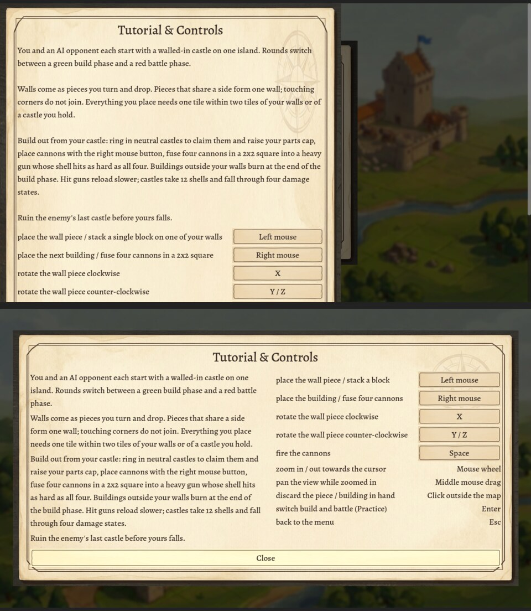

# Session 30: the Tutorial & Controls overlay fits the window

Sebastian, 2026-10-20: "The config menus button is invisible until I hover over it. The whole
menu is bigger than the game screen but only barely. Can you make it more compact so it fits?"

Roadmap: I57.

## What was wrong

Three faults in [Menu._show_help](/home/womb/repos/cannonade/scripts/Menu.gd) and the theme.

- **Too tall.** One 560 px column: the title, the tutorial in 14 lines, ten control rows and the
  Close button stood about 1020 px tall (headless: Close at y 930) in the 1280 x 720 canvas.
  The stretch mode (`canvas_items`, aspect `expand`) never makes the canvas shorter than 720,
  whatever the window, so the panel never fit.
- **Not centred, not closable by a click.** The scroll container of the 2026-10-19 playtest
  round gave its panel no expand flag, so Godot laid the panel at the top left at its minimum
  size, and the scroll area covered the dimmed backdrop, so a click beside the panel never
  reached the backdrop's close handler.
- **The invisible button.** Close takes the focus when the overlay opens. The theme sets the
  button's font colour and its hover and pressed colours, but not `font_focus_color`, so Godot's
  default (0.95, 0.95, 0.95) stood on the focus style, the hover parchment brightened 1.15.
  White on near-white: the button appeared only when the hover colour, the red, took over.

## Change

- The tutorial stands left (560 px, one label per paragraph, 8 px apart) and the controls
  right; the Close button runs the full width below. The panel is 1219 x 616 at 1280 x 720,
  centred the way the main menu's panel is (`PRESET_CENTER`, grow both ways). The scroll
  container is gone; the panel sits straight on the backdrop.
- Three labels shorter so the grid fits beside the text: "place the wall piece / stack a
  block", "place the building / fuse four cannons", "switch build and battle (Practice)".
  The binding buttons are 200 px wide.
- [ui/theme.tres](/home/womb/repos/cannonade/assets/art/ui/theme.tres) sets
  `Button/colors/font_focus_color` to the ink colour.

## Tests

`tests/menu_test`: the overlay panel inside the 1280 x 720 window and centred, the Close button
inside it, the focused Close keeps its font colour, a click on the parchment keeps the overlay
open, a click beside it closes it. 32 checks.

**Watched red** (each broken on purpose, the test red, then restored):

- the old layout: Close at y 930, the panel off centre, the click beside the panel changed
  nothing
- the panel set to pass clicks: the click on the parchment closed the overlay
- the focus colour unset: (0.95, 0.95, 0.95) against the ink
