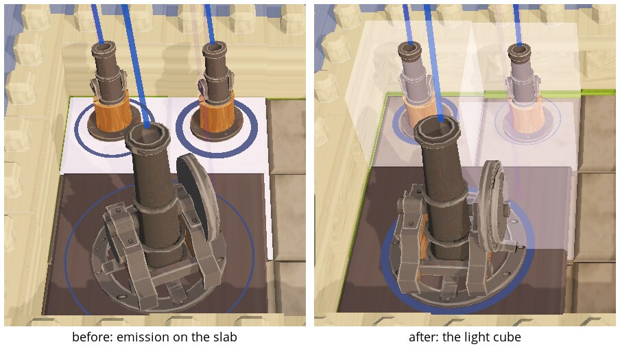

# Session 33: the targeting marker is a cube of light

Sebastian, 2026-10-20: "Currently, targeted tiles become white I think. I want the tiles targeted by
me to be highlighted... Maybe a literal light cube, making everything in the square of the tile
lighter as if a sunray hit it? I want it to still be more subtle than giving a white ground. Also
the ground does not help if it is obscured by a cannon or wall on that ground."

Roadmap: I60.

## What was wrong

The I43 marker wrote emission 1.2 on the tile slab alone: the ground under a shot in flight went
stark white, and a tile under a wall or a gun showed nothing of it. The I35 marker before it had
lit the slab and the model on it the same way, and castles flashed white for every shot.

## Change

[BuildingPlace.target_on](/home/womb/repos/grid-cannons/scripts/components/BuildingPlace.gd)
stands a box of light on the tile: a 1 m cube on the slab top, the size of a wall block,
unshaded, blend add, `WHITE.lerp(shooter colour, 0.3)` at alpha 0.3, fog off, no shadow. The
renderer adds the colour to whatever the cube's front faces cover, so the ground, the wall or
the gun inside it all turn lighter and no material of anything changes. `target_off` hides it
when the last shot aimed there lands; the refcount over shots in flight stands as before. The
cube is made on the first shot at a tile and reused; the box mesh is one for all tiles.

Not done: only the human's shots. Every shooter's shot marks its tile, tinted in the shooter's
colour, as before; the tint tells them apart now that the ground is no longer white.

Both crops: ai2, seed 4, five seconds into the first battle, the gun yard beside the top middle
castle, from master and from this branch. The two runs deal the sides mirrored, so each is framed
on its own yard.

## Tests

`tests/target_test`: the aimed-at tile carries a visible light cube, a tile wide and a wall block
tall on the slab top, additive and unshaded, alpha at most 0.4, tinted in the shooter's colour;
the slab and the castle on the tile carry no emission; a second shot keeps the light through the
first landing and the last landing clears it.

**Watched red** (each broken on purpose, the test red, then restored):

- the cube never added to the tile
- blend mix instead of add, alpha 1, the cube at the tile's origin instead of the slab top, the
  tint white: four checks red at once
- `target_off` hiding the cube whatever the count, and the old slab emission put back: three
  checks red
