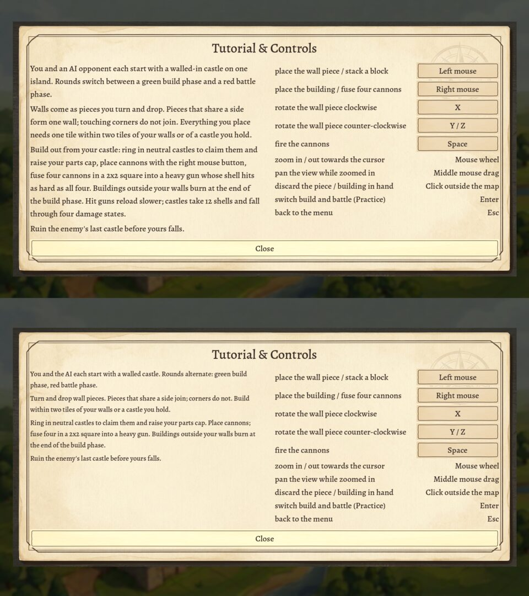

# Session 34: the tutorial reads snappy and smaller than the controls

Sebastian, 2026-10-20: "The tutorial text in the menu is too long. We dont need to be this exact.
make it snappy and choose a slightly smaller font than the other column where you can change
controls. Otherwise distinguishing between tutorial text and key binding is hard. Also make sure
the button at the bottom is placed right!"

Roadmap: I61.

## Change

- [Menu.INTRO](/home/womb/repos/grid-cannons/scripts/Menu.gd) drops the exact rules: the tile
  rule, the shell count, the damage states, the reload penalty. Four paragraphs, the longest
  three lines where it ran six.
- The tutorial labels get font size 17; the controls keep the theme's 20, so the two columns
  tell apart at a glance.
- The Close button keeps its place, full width under both columns: it stood inside the panel's
  content area, off the parchment's frame, at 1280 x 720, 1920 x 1080, 1280 x 1024 and
  1024 x 600. The test now guards that place.

## Tests

`tests/menu_test`: the four tutorial paragraphs use a smaller font than the control labels, no
paragraph runs past three lines, the Close button spans the panel's content width and every other
label and button ends above it.

**Watched red** (each broken on purpose, the test red, then restored):

- the old tutorial text: the third paragraph at five lines
- the font override removed: the tutorial at 20 like the controls
- Close moved into the controls column: 543 px wide against the panel's 1135
- Close added before the columns: the labels below it
