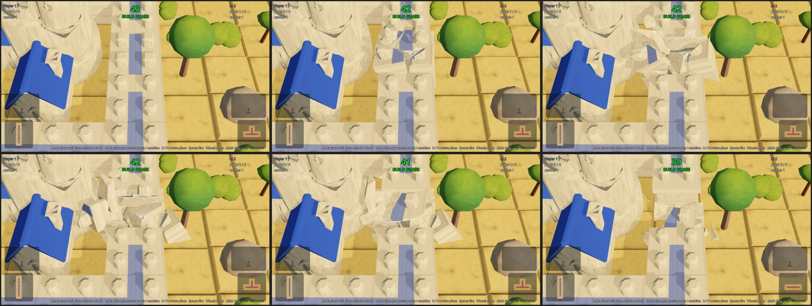

# Session 35: walls crumble when shot

Sebastian, 2026-10-20: "I want walls do explode / crumble when hit. Nothing special... can be
precomputed. Can you make a proof of concept to see how that may look? One way would be to
fracture the existing wall model and add physics to the elements and let them disperse or
crumble."

Roadmap: I62, a spike. The pieces are precomputed in Blender, the fall runs live in Godot's
physics.

## The pieces

[wall_fracture.py](../../game/assets/3d/wall_fracture.py) runs in the Blender behind `blx`
with `GAME_REPO` pointing at the checkout. It loads the plain block's and the storey's
`final.glb`, draws 16 and 14 random points inside the block (seeds 7 and 8), cuts each
point's Voronoi cell out of a padded box with one bisect plane per other point, and
intersects the block with every cell with the exact boolean. The outer faces keep the paint
and the region ids of the block. The cut faces get a box projection of the texture and
region 0, the body stone, so the game's wall shader paints the pieces like the block. Each
piece is one object with its origin at the centre of its bounding box.

The export writes
[wall_rubble.glb](/home/womb/repos/grid-cannons/assets/art/3d/wall_rubble.glb) and
[wall_rubble_upper.glb](/home/womb/repos/grid-cannons/assets/art/3d/wall_rubble_upper.glb)
without materials. The game gives the pieces the block's material.

| model | pieces | triangles | KB |
|---|---|---|---|
| wall_rubble | 16 | 623 | 105 |
| wall_rubble_upper | 14 | 570 | 92 |

## In the game

[Crumble.gd](/home/womb/repos/grid-cannons/scripts/Crumble.gd). When a shot's damage kills a
wall block (`BuildingPlace.damage_structure`) or a storey (`damage_stacked_wall`), the tile
calls `Crumble.crumble` before the block goes. The heap is a `Node3D` under the tile at the
block's art, so the slab top is its y 0. Every piece becomes a `RigidBody3D` with the piece
mesh in the block's `ShaderMaterial` and a convex shape, scaled 0.95 so touching pieces do
not start inside each other. The shapes are made once per mesh. The pieces get a velocity
away from where the shot was fired, 1.5 to 4 m/s sideways and 1 to 4 m/s up, a scatter of
0.8 m/s and a spin up to 8 rad/s, all drawn from `Art._rng`. They land on a `StaticBody3D`
with a `WorldBoundaryShape3D` at the slab top and on the standing walls: every wall block and
storey carries a static box of its art's bounds from the moment it is built or stacked
(`BuildingPlace._wall_body`), and the box goes with the block. When a block dies, the pieces
lying on it wake and fall. After 3 s the bodies freeze, the heap sinks 0.6 m in 1 s, and then
it is freed.

A first version gave each heap its own boxes for the four walls around and the block under a
storey. When that block died 0.5 s later, its pieces spawned inside the storey heap's box and
the physics pushed one 0.3 m through the slab. The test caught it.

Where the shot was fired from is `TileImpactor.start`. The three flights set it already,
each in its own declaration, now the base class declares it once. The tile gets it as
`damage_building_place(damage, from)`. A tile damaged from nowhere (`Vector3.INF`) throws
its pieces to a random side.

The sheet comes from `tools/godot_render.sh res://tools/screenshot.tscn -- --mode=versus
--look=19,8 --eye=5,3.5 --kill --at=2.9,3,3.25,3.6,4.2,6.6 --out=/tmp/game_crumble`. The new
`--kill` kills the wall nearest the look target at the first `--at` time, with the shot
coming from the camera. A fractional time names its file `_03.25.png`.

## Open after the spike

- Every look wears the plain block's pieces. Pieces per look are four more fractures for the
  base and four for the storey, eight files. The script takes an id per model.
- Live physics, not a baked animation. One kill is 16 convex bodies for 4 s. The sim-ai2
  test's frame times, master and this branch back to back, twice, are the same within the
  noise of the runs:

  | run | master p99 ms | crumble p99 ms | master max ms | crumble max ms |
  |---|---|---|---|---|
  | 1 | 36.8 | 37.4 | 71.0 | 58.9 |
  | 2 | 33.0 | 36.6 | 49.1 | 59.5 |
- The lab plays with rubble too, since headless Godot runs physics. A switch for the lab if
  its throughput matters.
- No dust and no sound (K5).
- The cut faces show bits of the painted atlas. A stone texture of their own needs a second
  material.

## Tests

`tests/walls_test._check_crumble`, with `Art._rng` seeded: a storey shot from the west
crumbles and leaves its block, breaks into 14 pieces that wear the storey's material, 14 of
14 lie east of the tile 1.5 s later and none inside the block or the wall east of it, the
block crumbles too, 1.5 s later no vertex of a piece of either heap is more than 0.1 m under
the slab top (the collision is the mesh shrunk 0.95 about its origin, and the lowest vertices
in the runs were 0.03 to 0.07 m under), and both heaps are gone 4.3 s later. 9 checks.

**Watched red** (each broken on purpose, the test red, then restored):

- the storey's crumble call removed: 0 heaps, 0 pieces, and the block's kill made only 1 heap
- the throw direction reversed: 7 of 14 east
- the heap's ground body not added: the lowest vertices 14.30 and 10.22 m under the slab
- the free at the end removed: the rubble still there after 4 s
- the material not set: the pieces without the storey's material
- the wall body not added when a wall is built: 1 piece inside a wall
