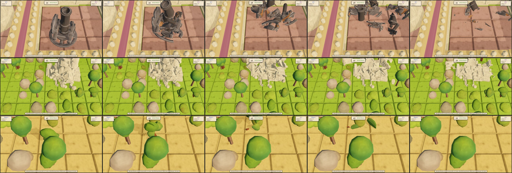

# Session 40: cannons, the castle, trees and rocks crumble

Sebastian, 2026-10-20: "The ai targets neutral castles, even when there are enemy castles left -
thats stupid, change. Crumble looks great, also make canons and the last stage of the castle
ruin crumble!" Then: "Also trees and rocks when they are hit!" and "And placing a wall on rocks
/ trees should make them crumble".

Roadmap: I69, a spike on top of I62. It ships the crumble of I66, the open question of
session 37; whether the ruin then goes and frees its ground stays open there. The targeting is
master's I65 from session 37, done in parallel: the AI shoots the castles the enemy holds,
nearest to ruin first, and never a neutral one. This session's own fix of the castle pool was
dropped for it.

## The pieces

[fracture.py](../../game/assets/3d/fracture.py) replaces the wall script. It loads a model's
`final.glb`, takes every mesh part but a gun's plate, and cuts each part in its own frame into
Voronoi pieces, the model's count shared among the parts by bounding-box volume, at least
three a part. The pieces sit under an empty named like the part, at the part's transform, each
with its origin at its centre. The export writes `assets/art/3d/<look>_rubble.glb` without
materials. The outer faces keep the part's paint, the cut faces get a box projection of it.
`wall_rubble_upper.glb` is now `wall_upper_rubble.glb`, the storey's look with the suffix.

| model | pieces | triangles | KB |
|---|---|---|---|
| wall | 16 | 647 | 108 |
| wall_upper | 14 | 566 | 89 |
| cannon | 3 barrel, 7 mount | 1269 | 129 |
| cannon22a | 3 barrel, 13 mount | 2544 | 303 |
| cannon22b | 7 barrel, 6 mount | 1493 | 195 |
| flak22 | 7 guns, 5 mount | 1455 | 169 |
| castle_d3 | 28 | 4848 | 523 |
| nature_leaf_tree, .2, .3 | 7, 6, 6 | 252, 213, 235 | 35, 27, 32 |
| nature_bush, .2, .3 | 5 each | 156, 154, 144 | 22, 21, 19 |
| nature_boulder, .2, .3 | 6 each | 167, 159, 164 | 25, 23, 24 |

A Voronoi cell that meets no geometry gives no piece, so the castle has 28 of 36 and a tree 6
or 7 of 8. The exact boolean runs hole tolerant, since the generated models are not manifold.

## In the game

`Art.instance` now records the look it picked on the node (`art_look`), so a decoration knows
which of its three looks it wears. [Crumble.crumble](/home/womb/repos/grid-cannons/scripts/Crumble.gd)
takes any node with a look: a building with its art under it, or a decoration, which is its
own art. For every part node of the rubble it finds the live part by name under the dying
thing, and places each piece at the part's global transform times the piece's own, so a
barrel's pieces start along the aimed barrel and a tree's follow the tree's scale and turn.
The piece wears the live part's material override or its first active material: a wall's
shader, a gun's paint. The heap stands at the art's foot, so the slab top is the ground.

Who crumbles:

- `BuildingPlace.damage_structure` and `UpgradeCluster.damage_structure` crumble whatever
  dies, a wall or a gun. A look without pieces, such as a supply, leaves no rubble.
- `Castle.become_ruin` crumbles `castle_d3` whatever state the castle wore, then sets the
  ruin. A castle killed from full health in one blow still falls as its severe look. When
  the look to crumble is not the one worn, a fresh instance of that look lends its parts'
  places and materials. The first version took them from the worn look, found no part named
  `castle_d3` under a healthy castle, and threw 28 white pieces. The sheet showed it.
- `BuildingPlace.destroy_decorations` crumbles every decoration of a tile shot
  (`damage_building_place` clears the decorations first) or built on, once
  `GameController.started` is set. The map build and the start castles clear their ground
  quietly, before that flag. A ring closing round a tile clears it quietly too: a big ring
  would throw a hundred pieces or more at once, and nobody asked for it.
- The decorations make no sound. The ground hit already plays one.

The gun row is an AI's heavy cannon at 29, 25 in the ai2 game of seed 1 at 100 s. The castle
row is the neutral castle at 34, 8 in versus: since master's I65 a shot that ruins a side's last
castle ends the game at once. The tree row is the tile at 16, 17. Each first frame is the first
one after the kill, the pieces still in the thing's shape. The sheet comes from `tools/screenshot.tscn` with the
new `--kill=gun`, `--kill=castle` and `--kill=tree`, which shoot the thing of that kind nearest the look target as it stands at the
first `--at` time and turn the camera to it.

## Frame time

The first full run had the sim's median frame at 10 ms against master's 0.6 ms. A probe counted
up to 78 heaps alive at once in the versus sim, which builds walls over trees all the time,
with 23,218 collision pairs: every heap brought its own infinite ground plane, so every piece
of every heap paired with every heap's plane. Three changes followed:

- One ground plane at the slab top for every heap of the game (`Crumble._floor`). The pairs
  fell to about 1,500.
- The project runs Jolt, Godot's built-in second physics engine
  (`physics/3d/physics_engine`). The game uses no other physics: the mouse picks by a ray
  against the ground plane, and no script runs on the physics tick.
- A decoration's pieces collide with the ground, the walls and building rubble, not with each
  other (`Crumble.DEBRIS`, layer 2). A tile of five trees throws 30 pieces.

With the decoration crumbles switched off the median was 0.48 ms, level with master, so the
trees, bushes and boulders carry the whole remaining cost. The sim steps physics twice a
frame at its fixed 30 fps, where the game at 60 fps steps once.

The two sims of the suite, master and this branch back to back, twice each. The median frame
rises by about 2 ms in versus and 0.8 ms in ai2. The p99 and the worst frame stay within
master's spread:

| sim | run | master p50 ms | branch p50 ms | master p99 ms | branch p99 ms | master max ms | branch max ms |
|---|---|---|---|---|---|---|---|
| versus | 1 | 0.70 | 2.67 | 41.2 | 36.6 | 62.6 | 53.0 |
| versus | 2 | 0.72 | 2.66 | 37.4 | 38.5 | 55.6 | 62.9 |
| ai2 | 1 | 1.02 | 1.80 | 49.6 | 37.5 | 82.3 | 67.4 |
| ai2 | 2 | 0.87 | 1.62 | 51.3 | 34.5 | 75.8 | 70.2 |

## Open after the spike

- No rubble for the 2x2 supports and supplies, the base and the upgrades. The script takes an
  id and a count per model.
- The cut faces of painted models show bits of their atlas.
- The castle's pieces fall inside the ruin's footprint, which has no collider, and the ruin
  hides them.
- The castle's pieces get the wall's throw. A collapse with a smaller sideways throw may read
  better for a thing 2.7 m wide.
- The decoration rubble costs about 2 ms of the sim's median frame. Fewer pieces per tree or an
  earlier freeze would cut it, at some cost to the look.

## Tests

`tests/walls_test._check_crumble` gained: the fourteen tiles it uses are free and dry (the
I62 check had stacked on a tile another check had walled); a cannon built and shot crumbles,
its mount and barrel in 7 and 3 pieces, the mount's pieces in the mount's material, the
barrel's pieces within 0.4 m of the barrel (0.25 m in the runs); the castle shot
falls to ruins in 28 pieces, all in the severe look's stone, a neutral castle, since a side's
last castle ends the game and clears `started`; three tiles get two leaf trees
each by hand (the test's game has no decorations), a shot clears one tile's trees into two
heaps, a wall placed on the next does the same, and a ring closing round the third clears it
with no heap; every heap of the five tiles is gone 4.3 s after the last kill. 10 checks more.

`tests/preview_test._check_quiet_build`: the decorated versus game of seed 7 starts with 653
decorated tiles and no heap. 1 check.

**Watched red** (each broken on purpose, the test red, then restored):

- the barrel's pieces placed by the art and not the live part: the farthest 0.71 m from the
  barrel, and the storey's and the mount's pieces without their material
- the part's material not set: the storey's and the mount's pieces without it
- only walls crumble, as in I62: the cannon made 0 heaps
- the castle's crumble call removed: 0 pieces
- the castle's look not lent: 0 of 28 pieces in the stone
- the decorations' crumble call removed: 0 heaps for the shot tile and the walled tile
- a closing ring crumbling its trees: 2 heaps
- the started gate removed: 212 heaps after the map build
