# Cannonade design bible

This document sets the look of Cannonade, the game with the project name Grid Cannons (D26). Everyone who makes art for the game reads it first: Sebastian, the agents that write prompts and build assets, and any artist who joins later.

Version 0.1. Version 0 was approved by Sebastian and tagged `bible-v0`. Session 06 added the gun budgets of D37 to chapter 3 and the block mapping of D32 to chapter 6. Version 0.2 (session 11, D53) amends the wall-face rule of chapter 7. Version 0.3 (session 26, D78) adds the wall looks and the walkway colour to chapters 2 and 3.

## How to read this document

Each chapter covers one part of the look. It names the round of images it came from, the decisions behind it, and the file that holds its exact numbers. The images at the end of a chapter show the rule. Where text and image disagree, the text is the rule.

A rule changes only through a new decision entry and a new version of this document.

These terms appear throughout:

- **Decision, D1 to D37.** An entry in [decisions.md](../../docs/decisions.md). It records what Sebastian decided and why.
- **Round.** One batch of images in [rounds/](rounds/), with Sebastian's picks and comments in its `PICKS.md`.
- **Phase.** A step of the art-direction process in [art-direction.md](../../docs/process/art-direction.md), from A, the theme, to I, the first assets.
- **Tile.** One square of the game board, 1 m by 1 m.
- **Default view.** The game camera at its normal zoom. A tile is 24.7 px wide there, and a wall of 1 m is about 13 px tall.
- **The 13 pixel test.** An image scaled down to the default view, to check what still reads at the size the player sees.
- **Anchor.** An approved image that a prompt attaches, so the image model copies its look. The anchors are listed at the end.

## 1. Theme and mood

From phase A, round [02-mood](rounds/02-mood/PICKS.md). Decisions D15 and D20.

### The world

Cannonade's world is a painted wooden toy fortress on a board of square tiles. The sea is one kind of tile, like grass, sand and rock. Everything inside the walls is under construction. The ships are toys with striped sails.

### The era

The base era is the age of sail: a merchant harbour and a naval dockyard, with a stone keep and medieval towers. A toy maker builds them. The materials are oak, stone and dark iron.

The guns grow bigger as the game goes on, and the bigger guns belong to later eras. Chapter 6 describes this era ladder (D16, D28). The smallest gun, on one tile, stays in the base era.

### The tone

Three words: cheerful, chunky, sunlit.

The build phase feels like stacking painted blocks on a board game. It is friendly and quick. Resource blocks of timber, stone and iron visibly stack into the guns (D17). Which block stands for which resource is decided later.

The battle phase feels like a fairground shooting gallery. Guns pop, water splashes, smoke rises in round puffs, and a hit ship tips over like a toy. No wreckage stays, and no fire keeps burning.

### Motifs that repeat

- Striped sails.
- Crenellations shaped like teeth.
- Barrels and crates.
- A flag on every tower.
- Pebble beaches.
- Round trees.
- A small flat cut, the chamfer, on every block edge (chapter 3, D22).

From the shipwright's island, a frame Sebastian liked:

- Wooden cranes and pulleys.
- A slipway with a half-built hull.
- Scaffolding.
- Coils of rope.
- Stacked timber, stone blocks and iron bars.
- Copper-green roof plates on the yard buildings.
- The glow of a forge.

### Maps

A map is an island, a river or pure land, all made from one set of tiles (D20). Nothing in the look depends on water. Grass, sand and stone carry the look as much as the sea does.

### What the world is not

- **Not a battlefield.**
- **No table, room or hand.** Three frames of round 02 showed the board as a diorama on a table. That came from a fault in the prompt and is not part of the look.
- **Not a generic asset-pack island.** The toy look is deliberate: paint colours and chamfered blocks.
- **Not grimy.** No steampunk on the small guns, and no gears for their own sake.
- **Not as dense as a market town.** Sebastian liked a market town's density in one frame, but this world has more open space.

### Images

The toy harbour board, six frames: the coast, the fortress from the game camera, the harbour at another time of day, a battle, the materials, the sky.

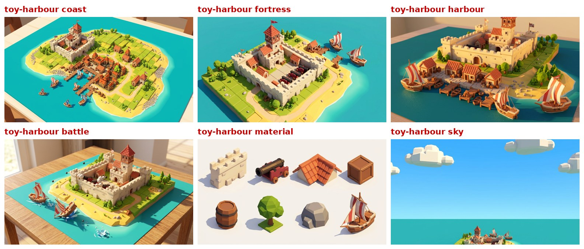

The shipwright's island: towers, cranes, slipways, scaffolds, the forge and stacked resources.

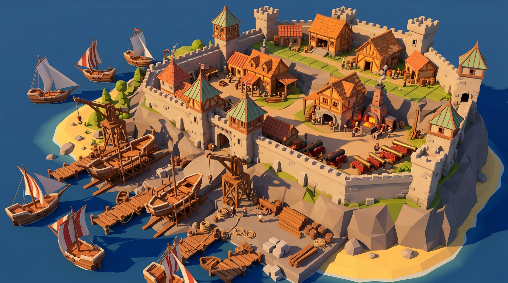

The round 01 frame that started the look (D15).

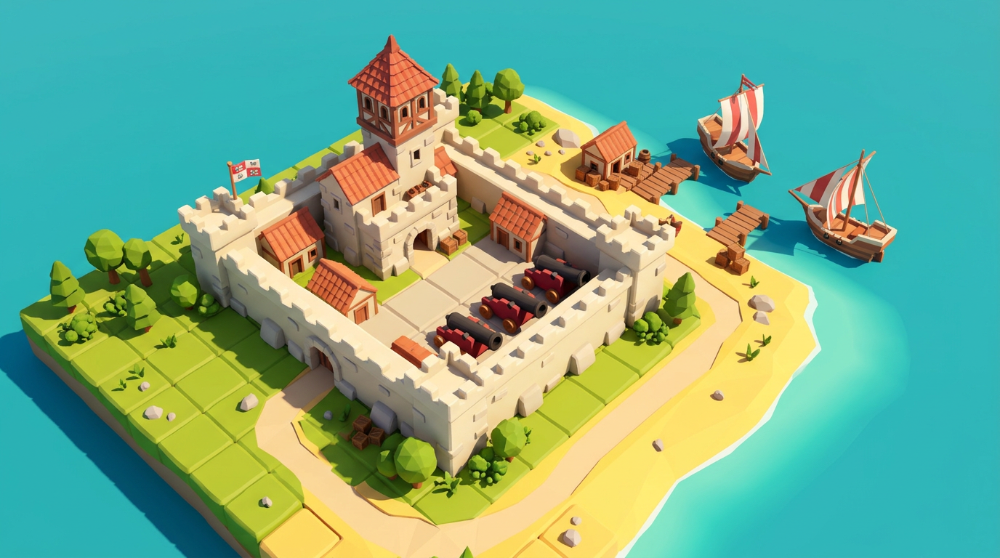

## 2. Colour

From phase B, round [03-colour](rounds/03-colour/PICKS.md). Decision D21. The exact values are in [palette.json](palette.json). The hex values in that file are the rule. Every material of the 3D assets and every UI colour reads from it.

### The palette: market-warmth

The palette brings a market town's warmth to the toy world: orange tile roofs, green grass, a blue sea, warm cream stone, dark timber and a warm haze at the horizon. Colours are saturated where the player builds and soft at the edge of the board.

| role | hex | used for |
|---|---|---|
| sea | #2f9fc9 | sea tiles, river tiles |
| sand | #f0c975 | sand tiles, beaches, paths |
| grass | #8fbf3c | grass tiles, the ground the player builds on |
| leaf | #3d7f34 | trees, bushes |
| stone | #e8d6b0 | walls, towers, the keep, rock |
| wood | #7a4a2e | piers, gun cradles, cranes, ship hulls |
| iron | #33302e | guns, iron bars, fittings |
| roofs | #d8632f | roofs of houses and towers |
| sky | #6cb9f5 | the sky, the panorama |
| fog | #efe3d0 | the horizon, the fade into the distance |

### Team colours

Each player has a team colour. The game shows it on the player's base building and on the aim arc.

| team | hex |
|---|---|
| blue | #2d55c4 |
| purple | #7b2fa3 |
| teal | #197059 |
| olive | #8c7a1f |

The rule: at the default view, a base in each team colour reads apart from the other three, on grass, sand, stone and sea. Every base shows its team colour on a flag and a coloured roof (D42). Every wall block shows its owner's colour on its walkway, the stone lerped 0.6 toward the team colour, and the walkway runs only toward the own walls beside the block (D78); the merlons and the stone stay cream.

The game's old deep blue and purple looked like the same dark block at 13 px. The bible corrected them, and the game now uses this set (roadmap F10).

### UI colours

| name | hex | used for |
|---|---|---|
| ui_light | #fbefd9 | panels |
| ui_dark | #3a2e28 | text and outlines |
| ui_accent | #c8322d | the one action a screen asks for |

### Open notes from the critics

Two image-model critics suggested changes. They stay open until a game screenshot shows the colours in place:

- **Grass.** Gemini would make the grass one step less saturated, #96b94f, so team colours and buildings stand out more from the ground.
- **ui_dark.** GLM would make ui_dark a cooler charcoal, about #2c3e50, so UI panels do not merge with wood and iron.

### Images

The palette.

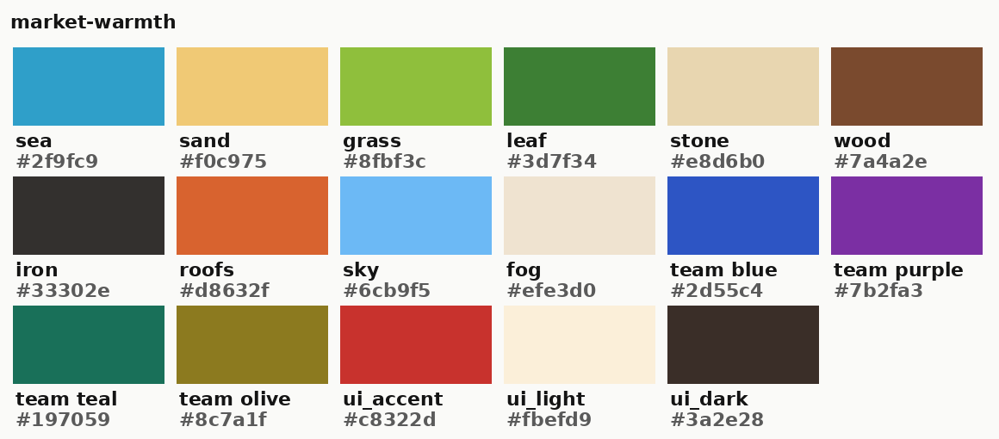

The round 01 frame recoloured to the palette. The image model only came close to the swatches. The table above is the rule.

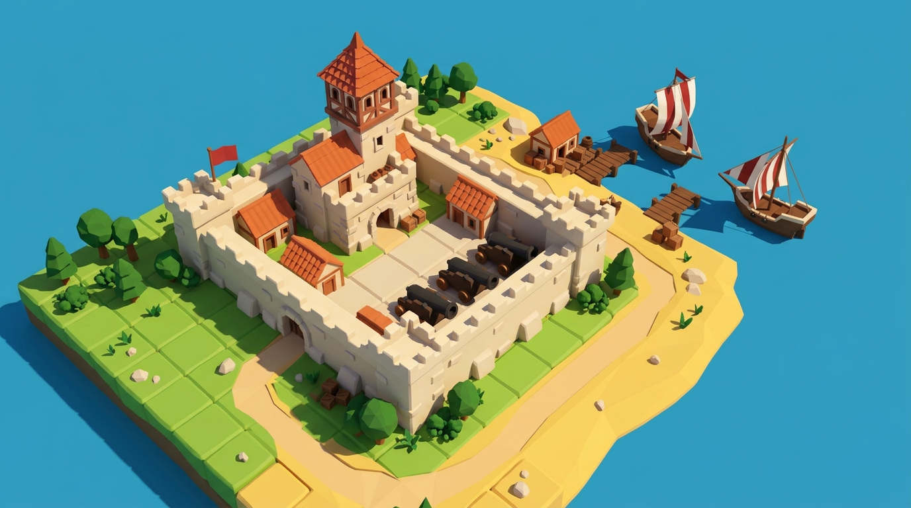

The 13 pixel test of the team colours: four team bases of one tile each, in the four colours, on each kind of ground, at the default view. Round 03 first ran this test at under half the game's scale, because it took the fortress wall for 1 m. Round 04 rendered it again at the correct scale.

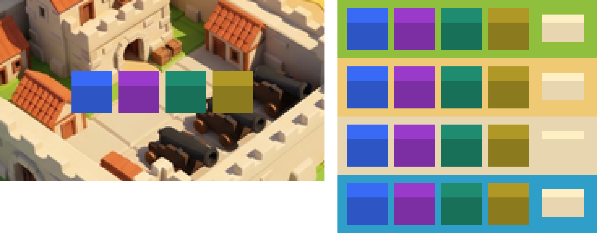

## 3. Shape language and detail level

From phase C, round [04-shape](rounds/04-shape/PICKS.md). Decision D22. The numbers are in [geometry_rules.yaml](geometry_rules.yaml). Every script that builds a 3D asset reads them from there. A mesh from an image-to-3D model is adjusted to them.

### Shape language: faceted and sharp, with a chamfer

- **Edges are hard and corners are crisp.** Flat faces show as flat faces.
- **Every block edge has one chamfer of 0.05 m.** A chamfer is a small flat cut along an edge. It makes a block read as painted wood and not as folded paper. The anchor frame already had this edge.
- **No rounded corners.**
- **Roofs are thin planes,** 0.05 m thick.
- **Merlons are square.** Merlons are the teeth along the top of a wall.
- **Nature follows the cover art (D41):** round-crowned trees about a tile wide in groves, a few conifers, piles of rounded boulders about a tile across, chunky and simple. This replaces the first rule of cones, icospheres and angular rocks. The nature round of session 08 sets the numbers.

Sebastian rejected the rounded, chunky language. Its edits made the bevel a quarter of a block instead of a tenth, and the fortress looked like clay.

### Detail level: River Towns

The detail level is named after the game River Towns. It was the middle one of three reference games.

- **A building** is one mass and one roof, plus one or two features: a door, a row of two windows, a chimney, or a crate or barrel beside it. That is five to eight parts.
- **A wall** has three parts: the slab, the row of merlons, and a ledge at the base or a walkway. The full-tile block (D75) comes in four looks, one per player: plain, corbelled, pilastered and coursed (D78); a look is flavour for the zoomed view, the colour tells the players apart.
- **Walls are plain slabs** at every level. No stones are drawn on them.
- **At most one prop** stands on a ground tile.

Sebastian rejected the other two levels:

- **Kingdoms and Castles** looks bare when zoomed in.
- **Foundation** adds timber frames, wells and carts, which are noise at the default view. Its edits also turned the keep into a timber house.

### The numbers

| rule | value |
|---|---|
| chamfer on every block edge | 0.05 m, one segment |
| roof thickness | 0.05 m |
| parts per building | 5 to 8 |
| parts per wall | 3 |
| smallest feature that shows at the default view | 0.15 m, which is 3.7 px |
| smallest merlon | 0.25 by 0.25 m, which is 6 by 3 px |
| gate | an arch at least 0.6 m wide, with a dark opening |

The triangle budget sets how many triangles a 3D asset may have:

| asset class | triangles |
|---|---|
| wall | 200 |
| building | 600 |
| gun, 1 by 1 | 1,100 |
| gun, 2 by 2 | 1,500 |
| gun, 3 by 3 | 3,000 |
| nature | 300 |
| terrain | 50 |
| prop | 300 |

### What the default view shows

At the default view, a wall of 1 m shows four things:

- a light band on its top
- a mid-tone face
- a dark shadow at its base, on its ground tile
- a notched top edge

It does not show stones, slits, texture, the chamfer, or anything on its face. Those appear only when the player zooms in to 96 px per metre: the chamfer, the shape of the merlons, a row of stones at the base, and the walkway behind the merlons.

### Silhouette

Every building reads from its outline alone: one mass and one roof. The roof is the block of colour that tells a building from a wall.

### Structures

These structures of the shipwright's island keep their shape in the toy style: the crane, the slipway, the scaffold, the tower, the forge, and stacked timber, stone and iron. The scaffold and the slipway are landmarks for the zoomed view, with thick posts and few parts. The tower follows the wall rule: no stones drawn on it.

### Maps

The look holds on a river map and on a pure land map. The tile grid runs to the edge of the board, and the sea is one kind of tile. On every map the weakest contrast is cream stone against a yellow sand path. The base shadow of chapter 4 separates them.

### The first real wall

The frames show a fortress wall of two levels, about 2 m tall. The game's wall piece is 1 m tall, 12 px at the default view, and a second level stacks another metre on it. The first real wall in the game checked the rules above in session 07, and they hold (D38):

- At the default view the wall shows a lit top band, the notched top edge and a shadow on its ground tile.
- Zoomed in it shows whole merlons with chamfered tops, a solid post at every corner and the band between two storeys.
- Every merlon stands on one tile. The game sets each tile to its own height, so a merlon split across two tiles would show a step.

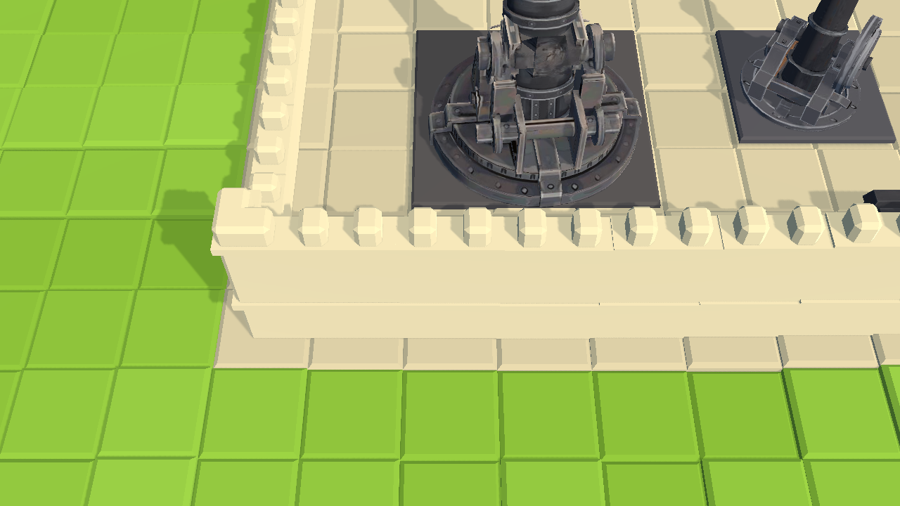

### Images

The six fortress corners. The rows are the detail levels, the columns the shape languages. Corner 4 is the pick.

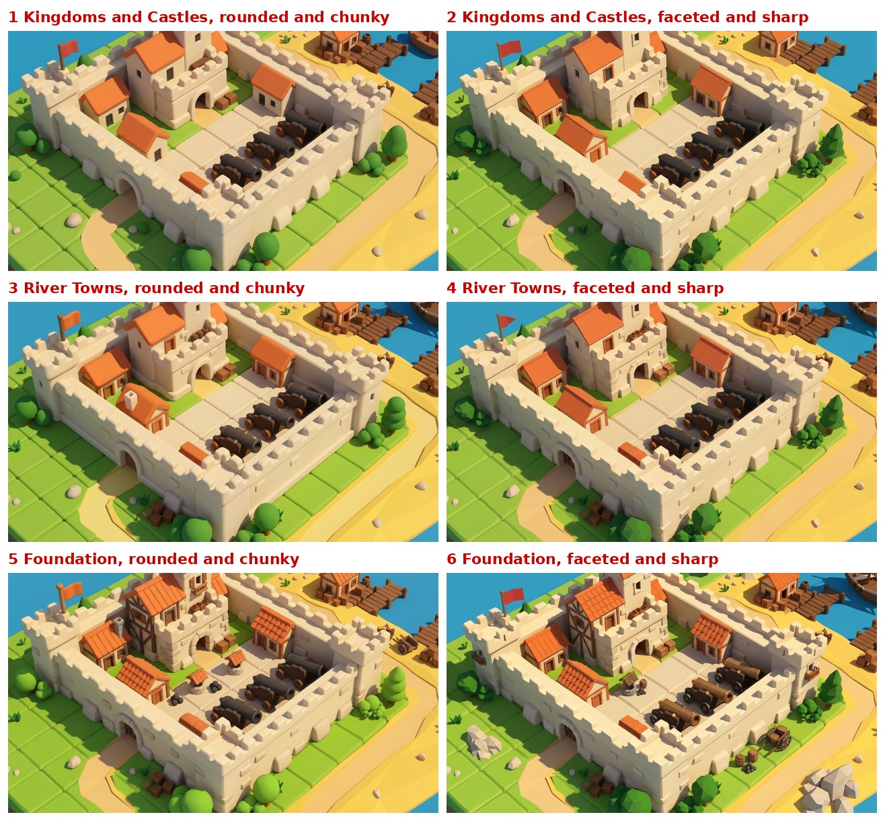

The picked corner: River Towns, faceted and sharp.

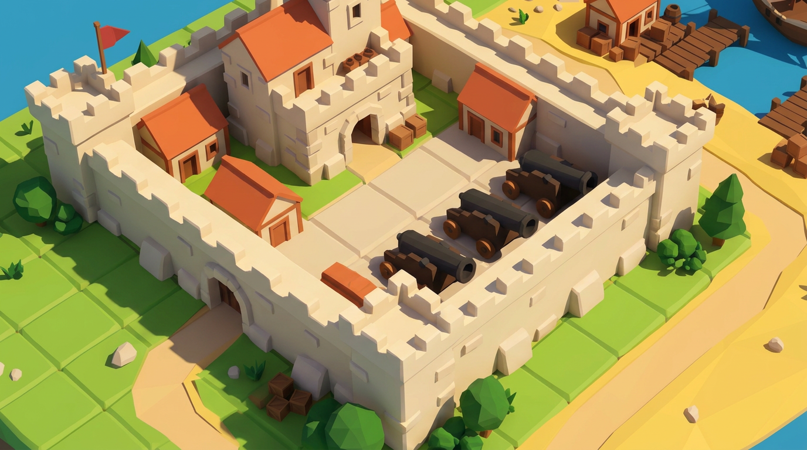

The anchor and the six corners at the default view, magnified four times.

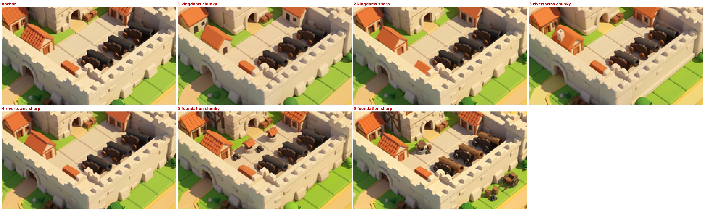

The shipwright's structures in the toy style.

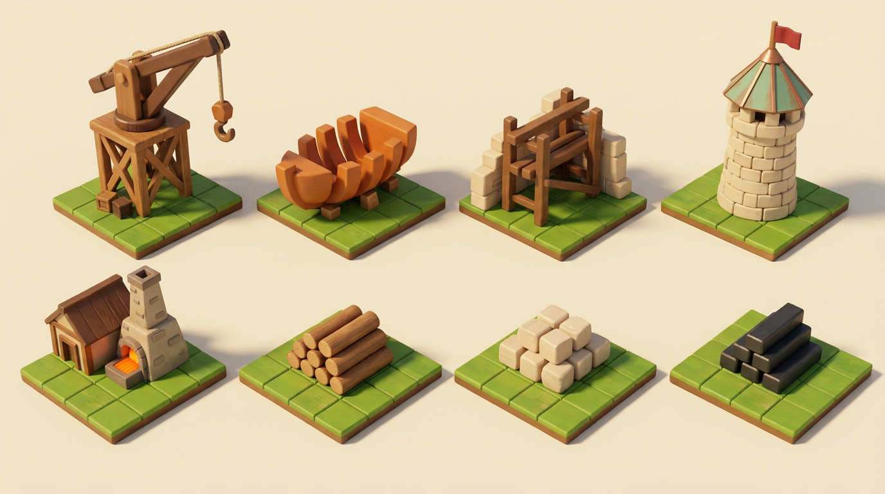

The island, the river map and the land map.

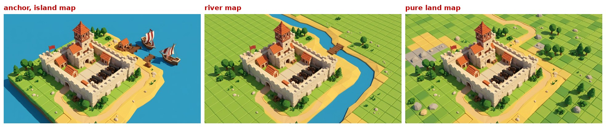

## 4. Lighting and atmosphere

From phase D, round [05-light](rounds/05-light/PICKS.md). Decision D23. The numbers are in [lighting_rules.yaml](lighting_rules.yaml). Nothing reads that file yet. Roadmap item C11 connects it to the game's light and to the preview renders of the 3D assets, so a preview and a game screenshot show the same light.

### The light: afternoon

- **The sun** comes from the front right, 45 degrees above the horizon and 40 degrees to the right of the camera's forward direction.
- **Lit faces are warm.** Shadows are medium and fall toward the camera and to the left.
- **A cream fog band** sits at the horizon, behind the board, never on it.
- **The sea is one flat blue.** A line of foam at the shore shows only in the zoomed view.

Two rules keep the board readable at 13 px:

- **The lit top face of a block is the lightest value in the frame,** after the sky. So the top of a wall reads as a light band.
- **Every wall and building casts a shadow onto its ground tile.** That base shadow is what separates cream stone from yellow sand at the default view.

### The numbers

| rule | value |
|---|---|
| sun elevation | 45 degrees |
| sun direction | 40 degrees right of the camera's forward |
| sun colour | #ffe8c0 |
| ambient colour | #a9c8e8 |
| ambient strength | 0.4 |
| shadow strength | 0.55 |
| shadow softness | 0.1 |
| sky | #6cb9f5 |
| fog colour | #efe3d0 |
| fog start | 1.0 times the board depth from the camera, so it starts past the far edge |
| fog end | 1.8 times the board depth |
| water | one flat colour per tile at the default view |
| post-processing | none: no bloom, no vignette, no colour grading |

The palette is the colour grade. Nothing else adjusts the colours.

### Rejected lightings

- **Noon** came first with the critics for readability. It has no warmth and the shortest base shadow.
- **Morning** is one step less saturated, and its long shadows fall across the courtyard tiles.
- **Depth fog** covers the far rows of the board, where the player builds.
- **Overcast** loses the base of the walls against the sand. It was the control case and proved that the shadows carry the readability.
- **Evening** turns the sea into a painting and hides the cannons in shadow. It suits store art, not the game.

### The engine lights the world

Two of the five relight edits also changed the colours of surfaces: the sea in the overcast frame, the grass and stone in the evening frame. So the game never lights a scene by recolouring a picture. The engine lights the world from the rules above. Since session 07 the game does: the sun, the ambient light, the sky colour and the fog of the afternoon, with a measured sun energy so that a lit top face shows its palette colour.

### Images

The world anchor. Every prompt for game art attaches this frame: the colour anchor with the picked shapes under the picked light.

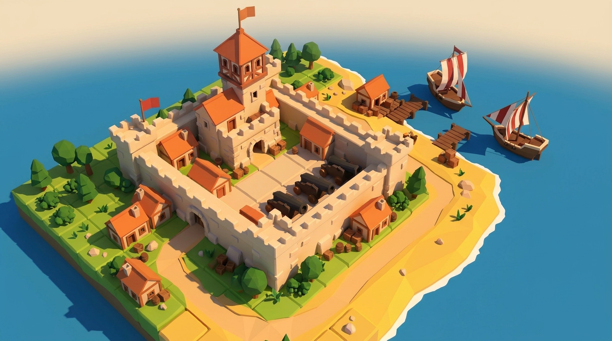

The six lightings. Lighting 3 is the pick.

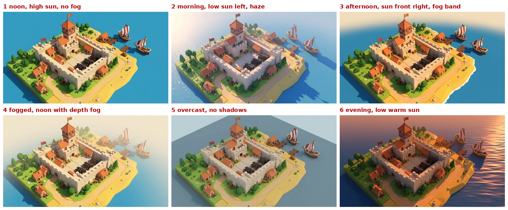

The six lightings at the default view, magnified four times.

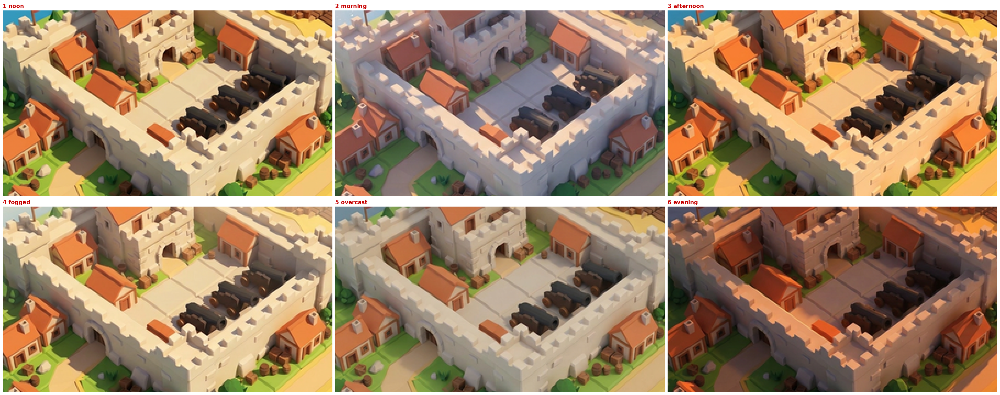

## 5. The game and its 2D art

From phase E, rounds [06-surfaces](rounds/06-surfaces/PICKS.md) to [15-cannonade](rounds/15-cannonade/PICKS.md). Decisions D24 to D27. The title's values are in [typography.yaml](typography.yaml).

### Two styles, one theme

The game and its 2D art share a theme but not a style.

- **The game is low poly.** The engine renders it by the rules of chapters 2 to 4.
- **The 2D art is painted.** The store art, the splash screen and the menu background are illustrations with soft brushwork, soft colours, and a painter's light and shapes.
- **Neither imitates the other.** A painting never pretends to be a screenshot. A screenshot on the store page is never painted over.

Both share the theme: toy castles with cream walls, square battlements and orange roofs, dark iron cannons, the tile grid, red and blue flags, rivers, round trees and a warm afternoon.

Round 06 made the store and menu images by editing the game's world anchor. Sebastian rejected all of them, because 2D art is its own style (D24). The store capsules of My Time at Portia, Doloc Town, Fabledom, Tiny Glade and The Wandering Village follow the same pattern, see [inspirations/notes.md](inspirations/notes.md).

### Each surface

**The game world**

- Colours from [palette.json](palette.json). The hex values are the rule.
- Shapes from [geometry_rules.yaml](geometry_rules.yaml): faceted and sharp, at the River Towns level.
- Light from [lighting_rules.yaml](lighting_rules.yaml), rendered by the engine.
- Seen through the gameplay camera.
- No text in the world. The HUD uses the UI font.

**The game's UI**

- Panels in ui_light, text in ui_dark, ui_accent only on the one action a screen asks for, the team colour on anything a player owns.
- Flat panels with a 3 px corner cut and a 2 px outline in ui_dark.
- One silhouette per icon, readable at 32 px.
- Panels sit at the window edge and leave the board uncovered.
- One font family on every screen, 16 px at the smallest.

**The store key art**

- The world's colours as the painter's starting point, softened.
- Painted 2D, a warm afternoon.
- Two castles seen from above in a cannon duel, with one shot in the air. The title sits in the open sky.
- The title is laid over the painting, with at most one line of copy.

**The splash screen**

- Made from the key art, in its style, with fewer elements.
- The title in the centre and one line for the studio.

**The menu background**

- Made from the key art, in its style.
- A quiet area where the button panel sits.
- The title, and the buttons in the UI font.

**Trailer stills**

- Title cards use the key art. Gameplay shots use the game.
- 16:9, with the title and one line of text.

### The key art

[marketing_style.png](anchors/marketing_style.png) is the key art (D25). Every 2D image is made from it, in its style.

It shows land seen from above, with a river and the tile grid. The near castle has a square keep, a timber lookout and a red flag. The far castle has a tower house with a stepped gable and a blue flag. A cannon at the front of the near castle fires one shot at the far castle. The far castle's front wall shows the damage of an earlier hit.

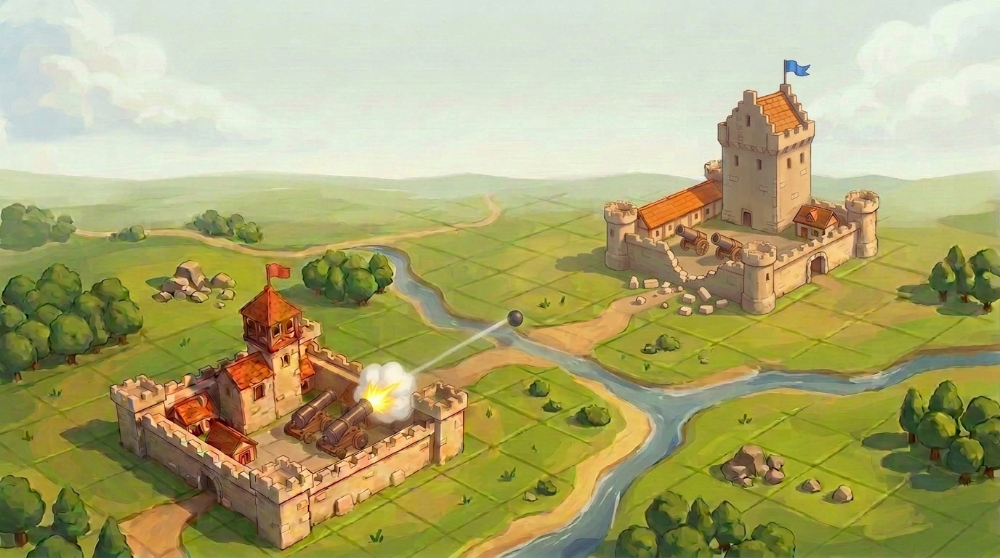

### Rules for every 2D image

Sebastian set these rules over rounds 07 to 13. They are kept in a [checklist](rounds/10-duel-checked/checklist.md). Before Sebastian sees an image, each rule is checked in a magnified crop: the near castle at 2x, the far castle at 4x. Only an image that passes every rule is shown.

- **Castles shoot at castles.** Ships are not the subject. The world is seen from above, where the game takes place.
- **Exactly one cannon fires.** It has a big plume of smoke, and its ball flies along the line of its barrel.
- **Cannons stand inside the walls, on the courtyard floor.** They point up at about 45 degrees to shoot over the wall. All cannons are the same size, two per castle. A cannon never stands on a wall, a wall walk or a tower.
- **The two castles are clearly different.** Each has its own keep, buildings and layout. Neither is a mirror image of the other.
- **The walls are straight and follow the grid.** No wall is round or curved. The grid runs parallel to the walls.
- **The land is not bare.** Trees, rocks, paths or water surround the castles, but the picture is not crowded.
- **The image carries no text.** The title goes on later as a separate layer.

### The title

- **The name is CANNONADE** (D26).
- **The lettering** is white hand-lettered capitals, from round 07's candidate 4. Sebastian called it the best text: readable, clean, nice.
- **The style is b:** white letters with a dark brown outline (D27). It still reads at 120 px wide, where plain white letters blur into the sky.
- **The logo is a transparent image,** [logo.png](anchors/logo.png). A script lays it over the art. It is never painted into a picture.
- **It sits on open sky.** It covers no castle, cannon, flag or shot.
- **A title is judged on a store capsule at its real size,** never on its own (D24).

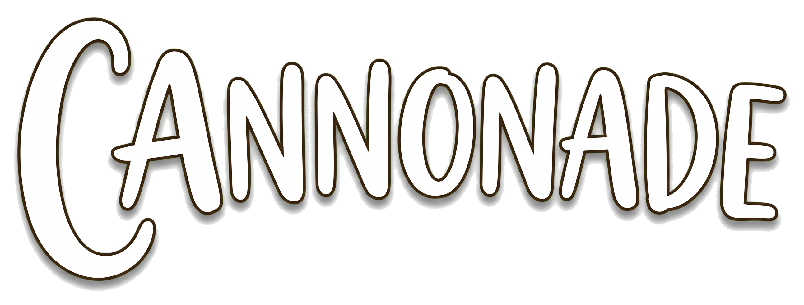

### The store set

The script [storeset.py](../../pipeline/storeset.py) makes every store and game image at its exact size. It works from three paintings and the logo: the key art, a portrait repaint for the tall capsules, and a wide repaint for the library hero, all from [round 14](rounds/14-store-set). The title is the only text. The library hero and the page background carry no text at all.

The set with lettering b is in [set-b-outline/](rounds/15-cannonade/set-b-outline). The game uses its logo, splash screen and menu background.

## 6. Era ladder and resource blocks

From phase F, rounds [16-era-ladder](rounds/16-era-ladder/PICKS.md) and [17-painted-sketches](rounds/17-painted-sketches/PICKS.md). Decisions D16, D17 and D28 to D31.

**Status: settled. Sebastian picked one gun per size and the four blocks (D29, D31).** Sebastian rejected round 16 as a whole. Its sketches looked like low-poly renders instead of paintings, and they started from the plan's assumptions instead of from what he wants. Round 17 started again from his brief and painted the guns and the blocks. His rules below come from his comments on both rounds.

### What the era ladder is

The player merges resource blocks into bigger guns. The blocks vanish when they merge, and the gun stands in their place. The era ladder sets how the guns look as they grow. The smallest gun belongs to the age of sail. The bigger guns belong to later eras, because the game wants big guns that the age of sail never had (D16).

### The sizes come from the game data

Every footprint in the game is a square of whole tiles. The game data has guns in three sizes:

| footprint | guns | other buildings of the same size |
|---|---|---|
| 1 by 1 | `cannon` | none |
| 2 by 2 | `cannon22a` to `cannon22d` | `flak22`, `shield22`, `supply22` |
| 3 by 3 | `cannon33a` to `cannon33c` | `rocket_station` |

So the ladder has three steps, one per size. D16 planned four tiers. D28 narrows them to three:

- **1 by 1:** medieval and age of sail.
- **2 by 2:** bigger guns.
- **3 by 3:** iron and early industry.

### Sebastian's rules for the guns (D28)

- **Standard artillery.** Every gun is a classic cannon with one barrel. No multiple barrels, and no mortars. Mortars come later as sidegrades.
- **Each gun is better than the last.** Every size looks visibly better and more advanced than the size below it. A bigger gun is never the same model scaled up.
- **One main colour.** Every gun is dark iron grey, #33302e. Bronze for the small guns and iron for the big ones would confuse the eye.
- **Wood on the small guns.** The small guns may use wooden parts. Iron replaces the wood on the bigger guns.
- **No wheels.** A gun only turns. It never drives. It sits on a round turning mount.
- **The gun is the attraction.** It fills its footprint.
- **A square plate under every gun** in the gun's own grey shows which grid squares it stands on, because a round mount is hard to make out on the grid. The plate stays square to the grid while the gun turns (D39, which amends the rule of no platform).
- **Sizes read.** Guns of different sizes never look the same size.
- **Cozy.** The guns look friendly, like toys, never like war machinery.
- **Shields are a variation.** A round shield suits a big gun. A small half shield, perhaps with a visor slit, suits a smaller one.

### Sketches are paintings (D30)

A sketch for a later 3D asset is a painting: loose brushwork, painted light, and the colours and shapes of this bible. It looks like a concept artist's sheet: cozy and bright, in the painted style of the key art, of the concept paintings of A Monster's Expedition, and of the cozy, bright store capsules Sebastian gave as references, see [inspirations/notes.md](inspirations/notes.md). A sketch shows things. It is not an exact 2D template for a 3D model. It never imitates the low-poly render, because a sketch decides form and proportion, and a fake render looks like bad 3D before any 3D exists. Sizes only need to read. A sketch is not measured.

### The resource blocks (D29)

Resource blocks are the one-tile pieces the game gives the player, `upgrade_a` and `upgrade_b` in the data. The player lays them in 2 by 2 and 3 by 3 squares, which merge into the bigger guns. Timber placed on timber makes the supply depot.

- **A box.** Every block is box-shaped, for three reasons. A box is easy to see on the board. A box visibly drops into a square field. Boxes stack.
- **One box size.** Every block has the same size, about 0.8 by 0.8 by 0.6 m, filling most of its tile.
- **One block per material.** No second variant of a material for now.

Sebastian picked four blocks:

- **Timber:** a wooden crate with log ends at its corners.
- **Stone:** stacked cream stone blocks.
- **Iron:** dark iron ingots, with no box. Two layers of three ingots, the upper layer turned 90 degrees, form a box. A stepped pyramid of ingots sits on top. The block reads as a box with a triangle on top, not as a triangle.
- **Gears:** an open wooden crate with one big iron cog inside.

The game has two block types, so two designs go into the game and two are reserves (D32):

- **Block A, `upgrade_a`:** timber.
- **Block B, `upgrade_b`:** iron.
- **Stone and gears:** reserves for a later upgrade tree.

### The picked guns (D31)

Round [17-painted-sketches](rounds/17-painted-sketches/PICKS.md) painted the guns from Sebastian's brief. He picked:

- **Small, 1 by 1:** an iron swivel gun on a thick wooden post with an iron foot.
- **Medium, 2 by 2:** a long iron gun in an iron-fitted wooden cradle on an open iron ring.
- **Large, 3 by 3:** a geared iron gun on a heavy riveted turntable, with no shield and no wood.

Each gun is visibly more advanced than the one below it: a post, then a cradle on a ring, then a geared iron housing on a turntable.

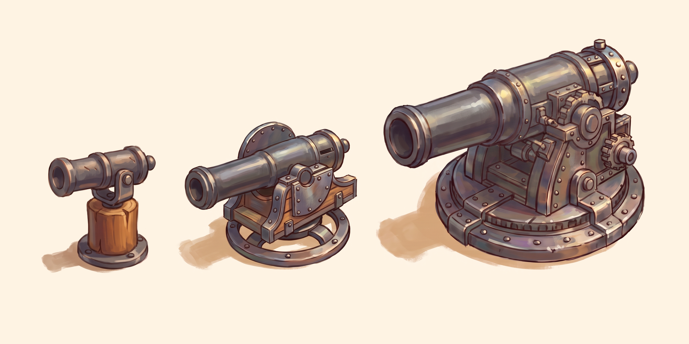

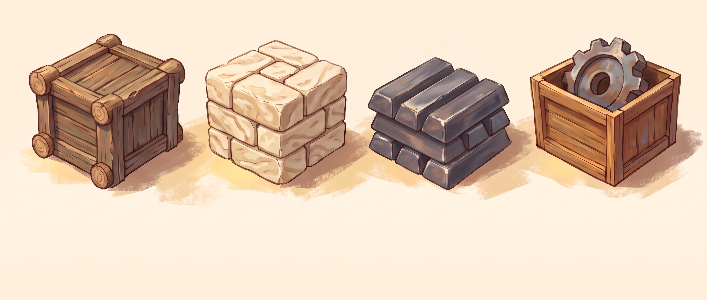

### Open
- **Brass.** The palette has no brass colour. Only a rejected steampunk gun used it.

## 7. Do not

Each rule names the chapter it comes from.

### Look and tone (chapter 1)

- No photoreal rendering.
- No gritty war and no horror.
- No pixel-art copy of the original game, Atari's Rampart.
- Nothing from Rampart: no logo, title treatment, box art or sprite.
- No generic low poly from an asset store.
- No modern star forts as the base look.

### Shapes (chapter 3)

- No clay look. A bevel is a 0.05 m chamfer, never a rounded corner.
- No rows of stones and no drawn detail on a wall face: the face carries the painted stone grain of the repaint round, nothing drawn on top of it (D53).
- No feature smaller than 0.15 m that has to read at the default view.

### Light (chapter 4)

- No fog on the board.
- No cast shadow weaker than 0.5.
- No bloom, no vignette and no colour grading.
- No lighting done by recolouring a picture.

### 2D art (chapter 5)

- No 2D image edited from the game's render.
- No title judged on its own.
- No text painted into the key art.
- No cannon on a wall or a tower.
- No cannonball off the line of its barrel, and no second shot.
- No ship as the subject of the key art.
- No round walls.
- No mirror-image castles.

### Guns, blocks and sketches (chapter 6)

- No wheels on a gun.
- No bronze or gold as a gun's main colour.
- No two gun sizes that look alike.
- No twin barrels for now.
- No mortars in the ladder.
- No resource block in a size different from the others.
- No wooden box around the iron.
- No concept sketch that imitates the low-poly render.

## Anchors

An anchor is an approved image that a prompt attaches, so the image model copies its look. All anchors are in [anchors/](anchors/). A prompt for a game asset attaches `world_style.png` for the look and `shape_corner.png` for the detail.

| file | what it shows | chapter |
|---|---|---|
| `theme.jpg` | the toy harbour moodboard | 1 |
| `structures.png` | the shipwright's island | 1 |
| `world_frame_r01.png` | the round 01 frame that started the look | 1 |
| `palette.png` | the palette | 2 |
| `colour_frame.png` | the round 01 frame in the palette | 2 |
| `team_13px.png` | the team colours at the default view | 2 |
| `shape_sheet.jpg` | the six fortress corners | 3 |
| `shape_corner.png` | the picked corner | 3 |
| `shape_13px.png` | the corners at the default view | 3 |
| `structures_toy.png` | the shipwright's structures in the toy style | 3 |
| `maps.jpg` | the island, river and land maps | 3 |
| `world_style.png` | the world anchor, for every game asset | 4 |
| `light_sheet.jpg` | the six lightings | 4 |
| `light_13px.png` | the lightings at the default view | 4 |
| `marketing_style.png` | the key art, for every 2D image | 5 |
| `logo.png` | the title | 5 |
| `gun_ladder.png` | the three picked guns, small to large, a painted sketch | 6 |
| `resource_blocks.png` | the four resource blocks, a painted sketch | 6 |

Later phases add `asset_examples.png` for the first assets and `ui_style.png` for the UI.
